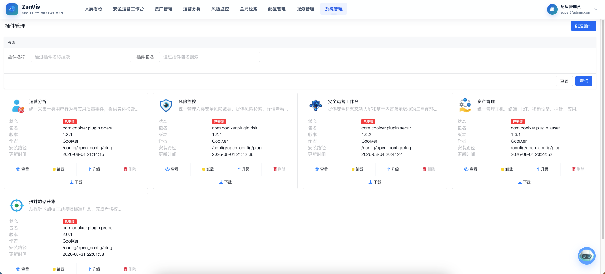
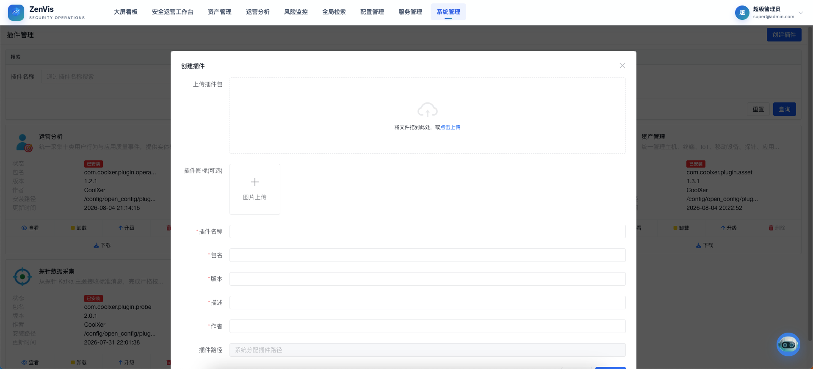
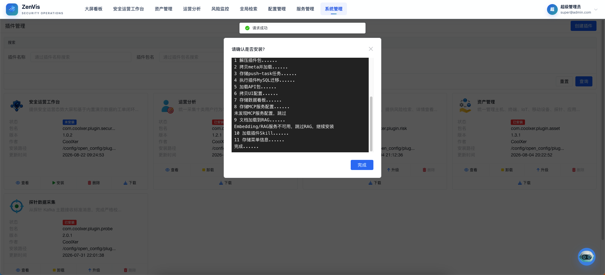
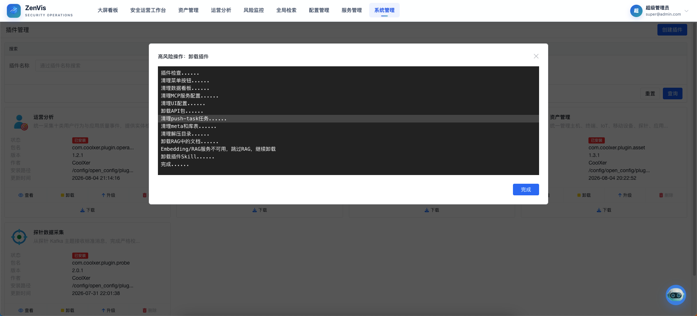

# 插件管理

## 功能定位

插件管理用于查看、安装、升级、恢复、导出和卸载 ZenVis 插件。插件是能力交付单元，可以携带元数据、数据接入服务、业务应用、菜单、页面和配套文档，但插件自己的使用说明由插件包内的 `README` 或 `00_doc` 维护。

## 进入方式

使用具备插件管理权限的账号登录，在顶部导航中直接点击 **插件管理** 进入。

## 页面说明

插件列表用于区分已安装插件、可用插件及其版本状态，并提供上传、创建、安装、升级、导出、恢复、卸载等管理入口。

插件详情集中展示说明文档、组成内容、版本信息和生命周期日志。执行变更前，应先通过详情确认插件来源和影响范围。

## 操作前检查

- 核对插件 ID、来源、签名/校验信息、目标版本、平台兼容范围和依赖。
- 阅读随包 `README`、迁移说明和卸载影响，备份相关配置与业务数据。
- 安排维护窗口并确认没有关键推送任务或页面正在依赖待升级组件。

## 核心操作

1. 查看插件详情和随包文档，确认插件提供的实体、服务、应用及依赖。
2. 点击“创建插件”，上传插件包；检查平台解析出的插件名称、包名、版本、作者和描述，不要仅凭文件名判断。

3. 点击目标插件的“安装”，在弹窗中核对版本、来源及安装日志，再确认执行。

4. 安装完成后返回列表确认状态和版本，并验证新菜单、实体、任务及看板。
5. 升级时上传同包名且版本更高的插件包，先阅读兼容与迁移说明，再执行升级。
6. 导出插件用于交付或备份；发生升级异常时，结合版本与日志评估恢复。
7. 卸载前确认插件页面、任务、表和业务数据已不再使用，在卸载确认框复核插件名称与影响范围后再继续。

## 预置插件（Bootstrap 目录）

面向首次部署场景，可在 `deploy/open_config/plugin-package_config/bootstrap/` 目录下预先放置插件包（`*.tar.gz`）。首次启动时平台会自动注册并按标准安装流程安装这些插件，无需手工逐个上传。

行为约定：

- 一次性执行：全部插件包处理完成后会生成标记文件 `.bootstrap-install.flag`，此后重启不再自动安装；
- 插件包在注册时写入 `zenvis-plugins` Bucket，布局为 `packages/{packageName}/{sha256}.tar.gz`；
- 卸载或删除预置插件后重启不会自动重装（标记文件已存在）；
- 个别插件包安装失败时，标记文件仍会生成，可在本界面对该插件点击「安装」重试；
- 后续替换更高版本插件包不会触发自动升级，升级仍走本界面或插件市场；
- 需要重新触发预置安装时，删除标记文件后重启即可，已存在的插件记录会自动跳过。

## 结果确认

- 生命周期日志全部成功，详情页显示正确版本和组成内容。
- 插件提供的 Meta、任务、页面、菜单、Skill 和 MCP 能力按声明出现。
- 测试角色授权后可使用业务入口；恢复或卸载后残留内容符合插件声明。

## 权限与约束

- 插件安装、升级、恢复和卸载会改变系统状态，仅授权管理员可以执行。
- 插件代码与配置拥有较高执行权限，只应安装来源可信且经过审核的插件。
- 卸载可能触发插件定义的清理逻辑，并影响关联任务、表或数据；实际行为以插件声明和平台日志为准。
- 本手册只说明内置插件管理页面，不重复维护具体插件的业务操作说明。

## 对象存储与本地缓存

插件包、升级候选和版本快照以 MinIO 为权威存储。`plugin_path` 字段保留，但值是不透明的对象键，例如 `packages/com.acme.demo/<sha256>.tar.gz`；调用方不得把它当作本地文件路径。

- 升级预检复制为 `upgrades/{packageName}/{operationId}/candidate.tar.gz`，旧版本快照为同目录下的 `snapshot.tar.gz`；
- 本地安装目录和 `{pluginRoot}/.cache/packages` 只是可重建缓存；启动时若已安装插件的本地目录缺失，后端会从 MinIO 重新下载解压，但不会重复执行 MySQL migration、菜单、推送任务等安装副作用；
- 升级成功、恢复成功或卸载后清理对应的候选/快照对象；卸载同时删除当前插件包对象；
- 旧记录若仍是本地绝对路径，会提示“插件包已迁移至对象存储，请重新上传并安装”，不会读取旧文件；
- 不提供存量插件包回填，升级到本版本后应重新上传并安装现有插件。

## 常见问题

### 插件安装后为什么没有看到新菜单？

检查安装日志是否成功、插件是否声明菜单，以及当前角色是否已获得新菜单权限；必要时重新登录刷新导航。

### 升级失败后应该怎么处理？

先保留现场并查看生命周期日志。确认新版本、依赖和数据兼容性后，再选择修复重试或使用平台提供的恢复能力。

## 插件介绍

以下页面用于快速了解各插件解决什么问题、提供哪些能力以及安装后从哪里进入：

| 插件 | 简介 | 介绍页 |
| --- | --- | --- |
| 惠尔特 HET-WAF-2516P 防火墙 | 接入 WAF Syslog，提供规则事件与原始事件检索和态势看板。 | [查看](zenvis-plugin-hetwaf-2516p.md) |
| 运营分析 | 统一十类用户行为与应用质量事件，支持检索、IP 调查和态势分析。 | [查看](zenvis-plugin-operation.md) |
| RzWeb 二进制逆向分析 | 浏览器内完成二进制反汇编、反编译和字符串分析。 | [查看](zenvis-plugin-rzweb.md) |
| 智能体安全监测 | 接入智能体安全事件与会话流，支持风险检索与会话现场还原。 | [查看](zenvis-plugin-sentinel.md) |
| Wireview PCAP 流量分析 | 浏览器内打开抓包文件，完成协议解码、过滤和流跟踪。 | [查看](zenvis-plugin-wireview.md) |
| 资产管理 | 统一管理十类资产，提供治理、IP 调查和资产态势。 | [查看](zenvis-plugin-asset.md) |
| 基础设施端点监测 | 采集并展示 MySQL、Redis、Kafka、ClickHouse 和 MinIO 运行指标。 | [查看](zenvis-plugin-infra-monitor.md) |
| Nginx日志监控 | 集中采集访问日志和错误日志，提供检索、详情和 IP 调查。 | [查看](zenvis-plugin-nginx.md) |
| QRSend 二维码离线传输 | 通过屏幕与摄像头在无网络环境传输文本、文件和文件夹。 | [查看](zenvis-plugin-qrsend.md) |
| 深信服 STA 潜伏威胁探针 | 接入 STA 55 类日志，提供流量、协议审计和安全事件分析。 | [查看](zenvis-plugin-sangfor-sta.md) |
| 探针数据采集 | 统一采集六类平台探针事实，提供详情和参数聚合分析。 | [查看](zenvis-plugin-synap.md) |
| 插件能力实验室 | 可运行的全栈插件样例，演示平台各层能力的组合方式。 | [查看](zenvis-plugin-lab.md) |
| 风险监控 | 统一管理六类安全风险，提供检索、IP 调查和风险态势。 | [查看](zenvis-plugin-risk.md) |
| 奇安信网神 SecGate 3600 NSG 防火墙 | 接入防火墙 Syslog，提供会话、威胁和系统事件分析。 | [查看](zenvis-plugin-secgate3600.md) |
| TraceHub 安全事件研判 | 接入 TraceHub，对 IOC 与 IP 做只读核验和 AI 研判。 | [查看](zenvis-plugin-tracehub.md) |

## 关联功能

- [菜单管理](../系统管理/菜单管理.md)：检查插件交付的菜单入口。
- [角色管理](../系统管理/角色管理.md)：为用户分配插件菜单权限。
- [元数据配置](../配置管理/元数据配置.md)：查看插件交付的实体配置。
- [数据推送服务](../服务管理/数据推送服务.md)：查看插件交付的数据任务。
