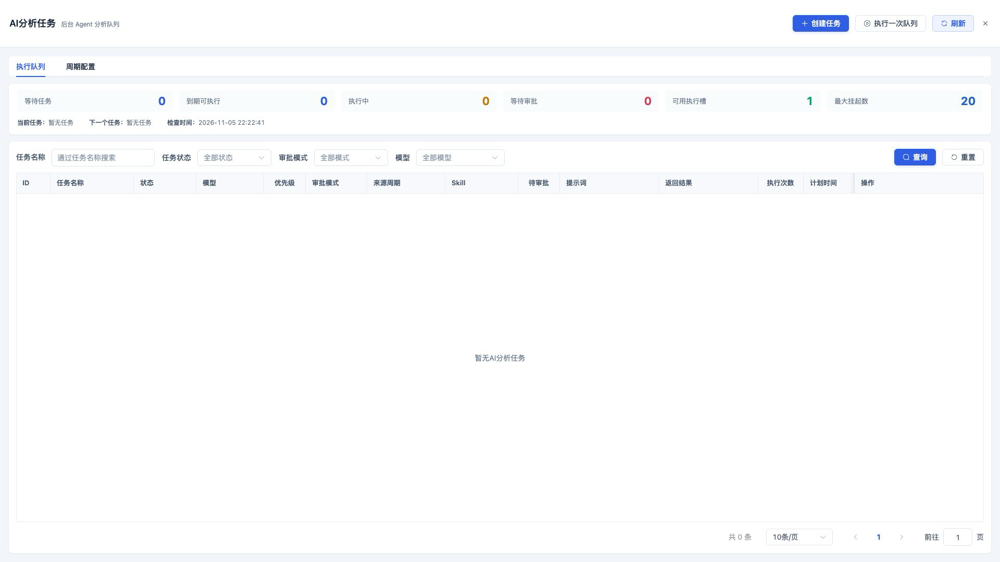
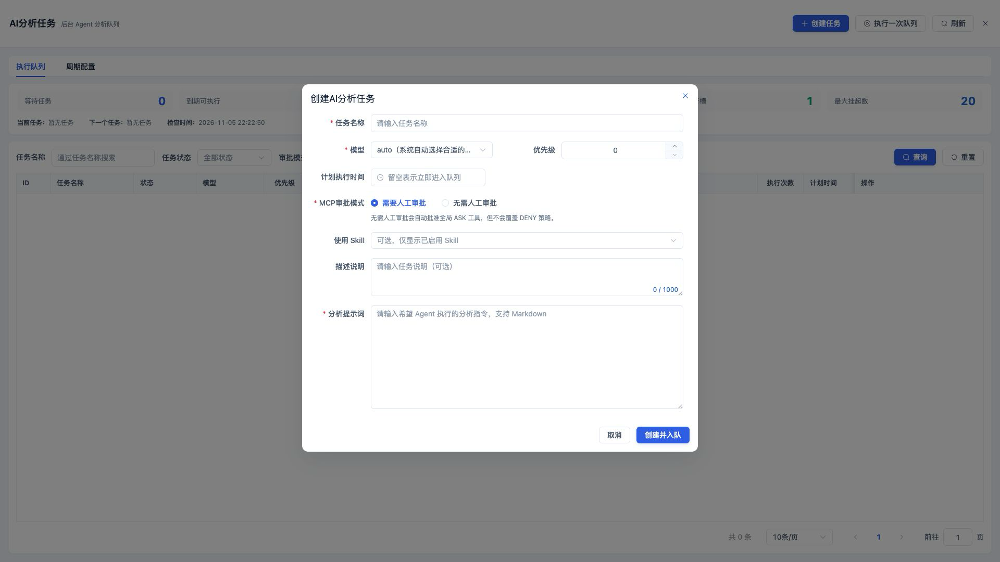
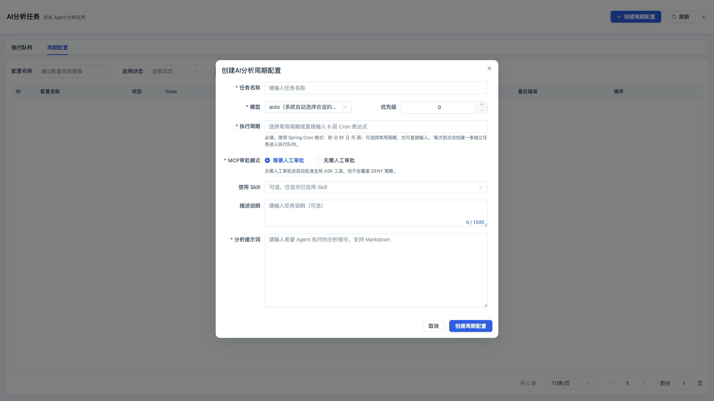

# AI 分析任务

## 功能定位

AI 分析任务把需要后台执行的 Agent 工作放入队列。单次任务是一个完整执行实例；周期配置只负责按 Cron 持续创建新的任务实例，因此每次执行都有独立的状态、结果和审计。

## 进入方式

在智能分析工作台右上角点击“分析任务”，系统从右侧打开“AI分析任务”抽屉。抽屉包含“执行队列”和“周期配置”两个页签，不是独立导航页面。

## 页面说明

- 顶部汇总等待任务、到期可执行、执行中、等待审批、可用执行槽和最大挂起数，并显示当前任务、下一个任务及检查时间。
- “执行队列”按任务名称、状态、审批模式和模型筛选，列表展示任务 ID、名称、状态、模型、优先级、审批模式、来源周期、Skill、待审批、提示词、返回结果、执行次数、计划时间和更新时间。
- “周期配置”展示配置名称、启用状态、Cron、最近错误等运行信息；每次到点会生成独立的一次性任务。
- 抽屉顶部提供“创建任务”“执行一次队列”“刷新”；切换到“周期配置”后提供“创建周期配置”。
- 人工审批模式下，待处理 MCP 请求会显示在“待审批”列并可从任务记录进入处理。

## 操作前检查

- 准备可独立执行的提示词，写清输入范围、输出要求、失败处理和完成判定。
- 确认所选模型与 Skill 可用，并核对任务可能调用的 MCP 工具策略。
- 计划执行时间和 Cron 使用部署实例时区；高风险任务优先选择人工审批。

## 核心操作

1. 打开“执行队列”，先按名称、状态或模型确认没有重复任务。
2. 点击“创建任务”，填写任务名称、模型、优先级、计划执行时间、MCP 审批模式、可选 Skill、描述说明和分析提示词；计划执行时间留空表示立即进入队列。

3. 需要重复执行时切换到“周期配置”并点击“创建周期配置”，填写任务名称、模型、优先级、执行周期、审批模式、可选 Skill、说明和分析提示词；Cron 使用 6 段格式（`秒 分 时 日 月 周`）。

4. 选择审批模式：人工审批适合写入或外部动作；自动批准只适合已评估的 `ASK` 工具。
5. 单次任务点击“创建并加入队列”；周期配置点击“创建周期配置”，保存后从下一个 Cron 匹配时间开始生成任务。
6. 出现 `WAITING_APPROVAL` 时打开审批入口，核对工具、参数和影响后及时处理。
7. 需要立即检查排队情况时点击“执行一次队列”；需要刷新统计和列表时点击“刷新”。
8. 每个周期生成的任务完成后保持 `SUCCESS`、`FAILED` 或 `CANCELED`；不再需要未来任务时停用或删除周期配置。

## 结果确认

- 任务进入预期队列，计划时间、优先级、模型、Skill 和审批模式显示正确。
- 成功任务能查看返回结果和执行次数；失败任务保留可定位原因的状态或错误信息，周期结果按独立任务行展示。
- 队列没有长期占用执行槽的僵死任务，待审批数量与实际请求一致。

## 权限与约束

- 执行中的任务不能直接编辑或删除。
- 人工审批请求具有过期时间；超时、取消和停止会结束未完成请求。
- 自动批准只影响任务运行中的 `ASK` 调用，不会绕过 `DENY`。
- 服务重启后未完成执行可能以新的 execution ID 重新入队。

## 常见问题

### 任务一直等待审批

打开任务的审批入口，检查是否存在未处理请求及其过期时间。

### 任务没有按计划执行

单次任务检查计划时间和队列状态；周期任务检查配置是否启用、Cron、下次触发时间和最近错误。必要时先点击“执行一次队列”让已到期任务进入执行流程。

## 关联功能

- [MCP 服务](/01-产品理念与使用/系统管理/MCP服务.md)
- [Skill 管理](/01-产品理念与使用/系统管理/Skill管理.md)
- [报表制作](/01-产品理念与使用/数智中心/报表制作.md)
