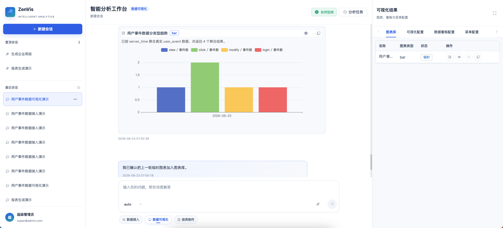

# 临时图表智能体

## 功能定位

临时图表智能体只负责基于已发布 Meta 查询真实数据，并生成当前会话可查看、可加入图表库的 ECharts 快照。它不创建可视化应用、数据大屏、配置或菜单，也不修改 Meta。

## 进入方式

进入完整数智中心，在功能入口选择“临时图表”。右侧工作台只展示“图表库”，不会再出现应用配置、看板或菜单页签。

## 操作前检查

- 目标实体和字段已由元数据配置智能体发布。
- 全局检索或实体分析能查询到目标实体数据。
- 已明确时间范围、维度、指标、聚合口径、排序和图表类型。

缺少 Meta、实体或字段时，智能体立即停止，不调用写工具。确认卡提供“前往元数据配置”入口，在新会话中预填缺失实体、表名和字段需求；不会自动发送，也不会自动调用其他智能体。

## 核心操作

1. 新建临时图表会话，描述指标、维度、时间范围和图表类型。
2. 核对智能体从真实 Meta 返回的实体与字段。
3. 检查查询方案中的实体、字段、过滤条件、聚合函数和排序，然后确认执行。
4. 查看临时图表，并核对数据证据、单位、记录数量和空值处理。

5. 确认快照通过真实查询校验后，点击“加入图表库”。加入动作由服务端复制已验证快照，Agent 不能自行伪造图表库记录。

## 结果确认

- 图表数值能与全局检索或实体分析结果交叉验证。
- 图表库记录来自本轮成功的数据 MCP，且查询方案已在服务端批准。
- 查询失败、Meta 变化或审批拒绝后，不沿用旧快照，也不生成图表库记录。
- 汇总、图表或后续报表素材只读取 `visualizationChart.chartLibrary`。
- 旧版 `dataVisualization.chartLibrary` 不迁移、不展示，也不作为报表素材。

## 权限与约束

- 只允许只读 retrieval 元数据与实体查询工具。
- 不包含任何 `config_*`、`dashboard_*`、`menu_*` 或 `push_task_*` 工具。
- 不生成 SQL，不写实体数据，不修改 Meta。
- 临时图表不会自动串联可视化应用、数据大屏或数据推送服务。

## 常见问题

### 图表为空

检查时间范围、筛选条件、实体是否有数据，以及字段是否适合聚合。

### 为什么不能加入图表库

只有通过真实查询校验、具备服务端工作流标识和完整查询参数的快照才能入库。缺少证据时应重新查询，而不是复用旧预览。

## 关联功能

- [元数据配置智能体](/01-产品理念与使用/数智中心/元数据配置智能体.md)
- [可视化应用智能体](/01-产品理念与使用/数智中心/可视化应用智能体.md)
- [数据大屏智能体](/01-产品理念与使用/数智中心/数据大屏智能体.md)
- [报表制作](/01-产品理念与使用/数智中心/报表制作.md)
- [全局检索](/01-产品理念与使用/全局检索.md)
