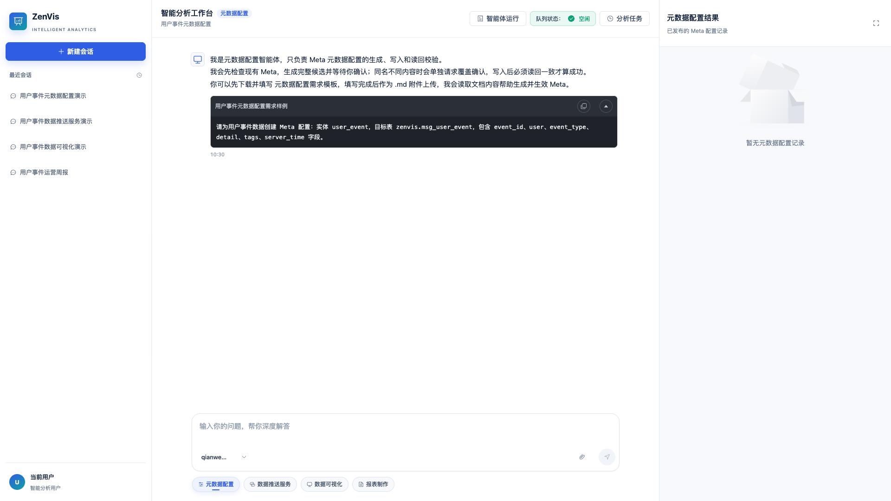
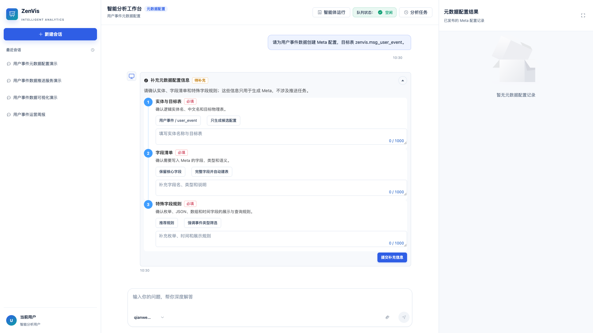
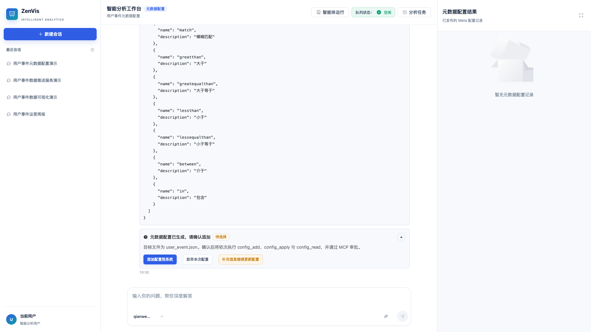

# 元数据配置智能体

## 功能定位

元数据配置智能体只负责把业务数据定义整理为可发布的 Meta：收集实体、字段、样例、类型和存储要求，生成完整候选配置，经用户确认后通过真实 MCP 工具写入并读回校验。它也可以在同一配置目录内重命名或删除已有的 Meta 文件和目录，但不会改写文件正文。

它不会创建数据推送任务，也不会在成功后自动跳转到数据推送服务。需要推送数据时，请单独打开[数据推送服务智能体](/01-产品理念与使用/数智中心/数据推送服务智能体.md)。

## 进入方式

进入完整数智中心，在功能入口选择“元数据配置”。右侧“元数据配置结果”只展示本次会话产生的 Meta 记录。

## 页面说明



- 中间对话区用于描述实体、字段、样例数据、语义和存储建议。
- 右侧面板只归集元数据配置记录；重命名后的记录显示新文件名和原文件名，已删除记录保留为历史墓碑且不能再打开。
- 内置演示只执行元数据配置流程，不生成推送任务。
- `config_add`、`config_apply`、`config_rename`、`config_delete` 等写工具使用真实 MCP 审批。

## 操作前检查

- 准备数据字典、脱敏样例、唯一键、时间字段、枚举、数组和 JSON 字段说明。
- 明确实体英文名、中文名、目标表名和字段展示规则。
- 确认本次只生成候选，还是允许写入 Meta；写入前仍会单独要求确认。

## 核心操作

1. 新建“元数据配置”会话，描述数据格式和业务语义，或上传填写后的[元数据配置需求模板](/zenvis/system-files/metadata-config-requirement-template.md)。
2. 信息不足时提交补充项。智能体只询问 Meta 所需信息，不询问推送链路参数。
3. 审阅候选实体、属性类型、物理列、操作符、展示规则和存储建议。



4. 确认添加配置。候选 JSON、文件名和内容摘要会在确认后锁定。



5. 若同名文件已存在且内容不同，平台会单独展示覆盖确认；不得静默覆盖。
6. 核对 `config_add`、`config_apply`、`config_read` 的 MCP 审批与参数，再决定允许或拒绝。


7. `config_add` 只创建空文件，并立即在右侧生成 `创建文件` 记录；`config_apply` 写入正文并完成严格加载后，`config_read` 读回且与锁定候选语义一致，才升级为应用成功记录。若文件已写入但应用失败，仍保留记录并显示失败状态。


8. 需要改名或删除时，智能体先读取真实配置树并锁定源路径。重命名只允许同一父目录内改名，目标已存在时不会覆盖；删除非空目录必须显式展示受影响文件并二次确认。
9. 改名或删除由 `config_rename`、`config_delete` 独立执行，不经过 `config_add/config_apply`，也不会重写文件正文。Meta 操作完成后平台必须严格重载并刷新 Schema，再按真实核验结果更新右侧记录。

## 状态机

```text
METADATA_INPUT_COLLECTION
  → config_tree
  → config_schema
  → config_validate（最多 3 轮）
  → 候选确认
  → 写前重查
  → 可选覆盖确认
  → config_add / config_apply
  → config_read
  → 成功记录或阻塞

META_DISCOVERY
  → 识别重命名或删除意图
  → config_tree（必要时 config_read）
  → META_OPERATION_DISCOVERY
  → 锁定源路径、目标路径与 operationDigest
  → META_OPERATION_CONFIRMATION
  → config_rename / config_delete
  → META_OPERATION_APPLY
  → 严格重载 Meta 并核验路径/内容
  → 成功、失败或阻塞
```

- 工具白名单仅包含 `config_tree`、`config_schema`、`config_read`、`config_add`、`config_apply`、`config_validate`、`config_rename`、`config_delete`。
- 同名同内容按幂等成功处理，不重复写入。
- `config_add` 成功后即可在右侧看到 `创建文件` 记录，不需要等到应用成功；审批拒绝、写入失败或读回不一致时不得标记为应用成功。
- 文件已写入但严格加载/读回失败时保留 `已写入` 或失败记录，并单独展示应用结果。
- 阻塞后可从失败账本指定检查点重试，也可补充要求重新生成候选。
- 改名或删除的路径、目标占用状态、源文件内容或目录成员发生变化后，旧确认卡失效，必须重新读取配置树并确认。
- Meta 文件已改名但严格重载失败时，保留已完成的文件操作并标记失败，不允许声明应用成功或自动回滚。

## 结果确认

- 右侧“元数据配置结果”出现记录，并可打开对应 Meta。
- Meta 应用成功后，全局检索、临时图表、可视化应用和数据大屏可以选择新实体与字段。
- 记录中的文件名、实体、目标表、字段数量和内容与读回结果一致。
- 重命名记录原位显示 `已重命名`、新文件名和原文件名；删除记录显示 `已删除`，保留历史但不提供打开入口。
- 右侧操作记录只由服务端在真实工具执行和路径核验后写入，模型生成的记录卡不能伪造或修改右侧记录。

## 权限与约束

- 智能体不能绕过 Meta Schema、MCP scope 或工具审批。
- 实体、字段或存储类型不明确时，应先补充信息再写入。
- “允许本次”只批准当前 MCP 调用，不等同于修改长期工具策略。
- 元数据配置成功后不会自动创建推送任务，也不会调用另一个智能体。

## 常见问题

### 配置已经生成但系统中没有文件

生成候选和写入系统是两个阶段；确认添加后还需要 MCP 审批和成功读回。

### 同名文件为什么没有直接覆盖

同名不同内容必须单独确认覆盖；覆盖仍需 `config_apply` 和 `config_read`。

### 文件已写入，为什么应用仍提示失败

进入元数据配置目录和完成运行态应用是两个结果。文件已写入或改名成功时右侧仍会保留记录，但只有严格 Meta 重载和 Schema 刷新成功后才标记为已应用；加载失败会保留现场并显示失败状态。

### 为什么删除目录前还要再次确认

非空目录会同时影响多个文件。确认卡会列出受影响路径并要求显式选择“确认递归删除”；服务端只使用卡片锁定的路径和摘要执行，过期或被修改的卡片不能继续操作。

## 关联功能

- [数据推送服务智能体](/01-产品理念与使用/数智中心/数据推送服务智能体.md)
- [元数据配置](/01-产品理念与使用/配置管理/元数据配置.md)
- [MCP 服务](/01-产品理念与使用/系统管理/MCP服务.md)
