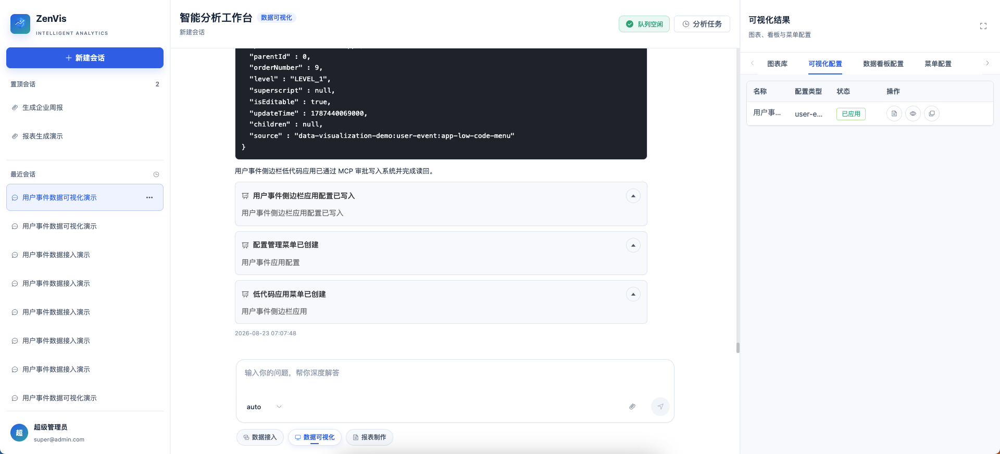
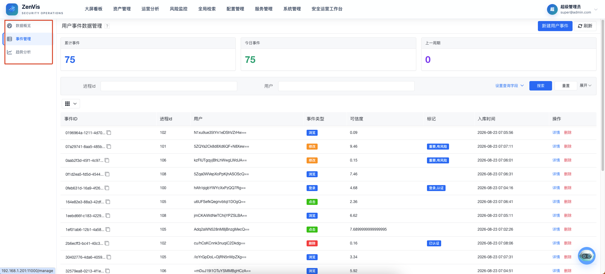

# 可视化应用智能体

## 功能定位

可视化应用智能体基于已发布 Meta 查询真实数据，生成低代码单页、侧边栏应用或静态 HTML 页面，并按需发布应用菜单。它不创建 Dashboard，也不生成临时图表库记录。

## 进入方式

进入完整数智中心，在功能入口选择“可视化应用”。右侧工作台分为“应用配置”和“应用菜单”两个页签。

开场白提供“单页面应用”“带侧边栏应用”和“添加菜单”三个独立示例。

## 操作前检查

- 目标实体和字段已发布，且能用真实数据验证查询方案。
- 明确应用名称、页面结构、目标 `configType`、文件名和访问菜单。
- 写入前确认同名文件是否允许覆盖，以及高风险 MCP 审批策略。

缺失 Meta、实体或字段时停止执行，不调用任何写工具。界面显示“前往元数据配置”深链，只预填提示词，不自动发送或自动调用其他智能体。

## 核心流程

```text
实现方式确认
  → 实体 Meta
  → 字段 Meta
  → 查询方案确认
  → 真实数据查询
  → 完整应用配置
  → 写入确认 / 覆盖确认
  → config_apply
  → config_read
  → 配置成功记录
  → 可选菜单确认
  → menu_create / menu_view
  → 菜单成功记录
```

1. 选择单页面、侧边栏应用或静态 HTML 实现方式。
2. 核对实体、字段和查询方案，再确认执行真实查询。
3. 检查完整应用配置、目标文件和写入范围。



4. 同名文件内容不同时必须单独确认覆盖；读回内容与批准候选一致后才生成配置记录。
5. 需要菜单时单独确认菜单名称、类型、路由和参数；菜单被拒绝时保留已成功配置，不伪造菜单记录。



## 结果确认

- 应用配置记录通过 `recordKind=config` 写入 `visualizationApp.configs`。
- 应用菜单记录通过 `recordKind=menu` 写入 `visualizationApp.menus`。
- 配置写入证据来自真实 `config_apply` 与 `config_read`，菜单证据来自真实 `menu_create` 与 `menu_view`。
- 查询数据只用于生成配置，不进入 `visualizationChart.chartLibrary`。
- 页面刷新后能加载，筛选器和交互控件行为正常。

## 权限与约束

- 允许 retrieval、`config_tree/config_ensure_root/config_add/config_apply/config_read` 和 `menu_*`。
- 不包含任何 `dashboard_*`、`push_task_*` 或 Meta 写工具。
- 配置内容、目标文件、configType、configIndex 和菜单参数在确认后由服务端锁定；变化后必须重新生成确认卡。
- 菜单发布失败或审批拒绝时停止，不输出成功记录。

## 常见问题

### 配置没有写入

检查写入确认、覆盖确认、MCP 审批、`config_apply` 和 `config_read` 是否完整。

### 已生成页面但菜单中看不到

确认菜单已单独确认并创建，角色已分配权限，并重新登录加载最新菜单。

## 关联功能

- [元数据配置智能体](/01-产品理念与使用/数智中心/元数据配置智能体.md)
- [临时图表智能体](/01-产品理念与使用/数智中心/临时图表智能体.md)
- [数据大屏智能体](/01-产品理念与使用/数智中心/数据大屏智能体.md)
- [静态页面配置](/01-产品理念与使用/配置管理/静态页面配置.md)
- [菜单管理](/01-产品理念与使用/系统管理/菜单管理.md)
