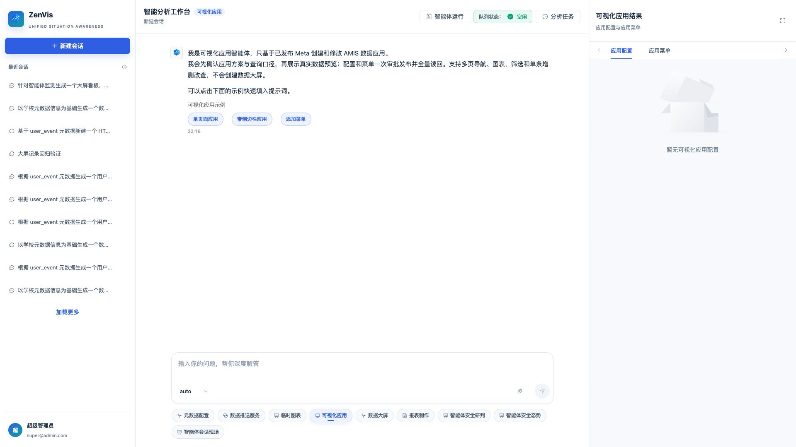
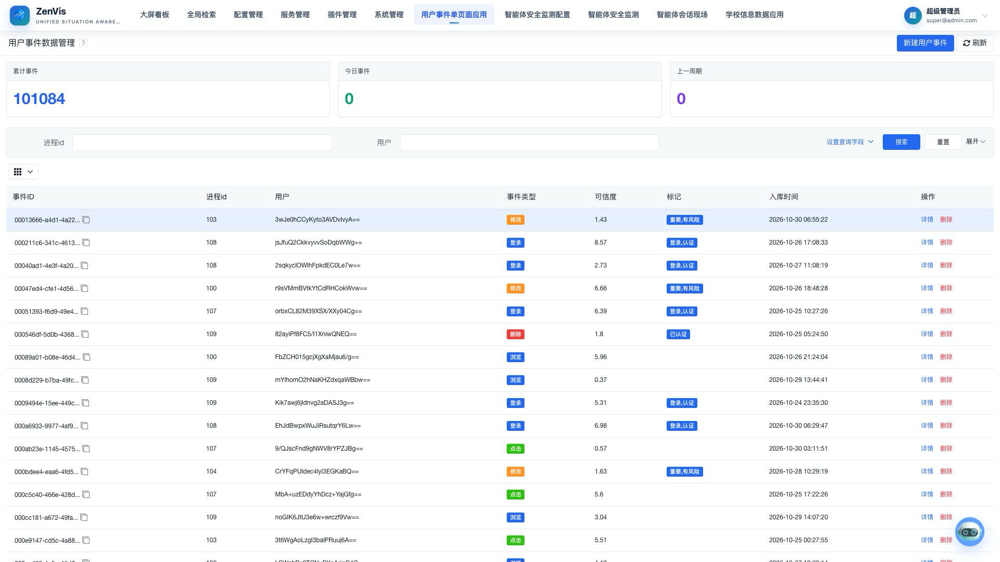

# 可视化应用智能体

## 功能定位

可视化应用智能体通过对话创建和更新 AMIS 数据应用，支持多页导航、指标卡、图表、实体列表、筛选、详情、新增、编辑和单条删除。应用只引用已发布 Meta，由服务端确定性编译 AMIS 并绑定现有实体查询、CRUD、映射和自动补全接口。

它不创建 Dashboard，不写入临时图表库，也不生成任意 AMIS 节点、API 地址、JavaScript、SQL 或配置文件正文。静态 HTML 页面仅作为历史应用只读兼容，不参与新链路的创建、更新、预览和发布。

## 进入方式

打开智能分析工作台，在底部能力入口选择“可视化应用”。右侧“可视化应用结果”提供“应用配置”和“应用菜单”两个页签，按 `appId` 聚合展示应用版本、页面列表、配置状态、菜单状态、部分成功和菜单重试入口。

## 操作前检查

- 目标实体、字段、操作符、枚举、映射和展示类型已发布。
- 明确应用名称、页面结构、查询口径、首页和是否发布菜单。
- 修改已有应用时，先读取当前 `app_version`、`spec_digest`、页面和受管文件摘要。
- 同名目录已有文件但没有 `_app.json` 时，该目录视为历史应用，只读展示，不自动接管或覆盖。

缺失 Meta、实体或字段时停止执行，不调用任何写工具。界面显示“前往元数据配置”深链，只预填提示词，不自动发送或自动调用其他智能体。

## 核心流程

```text
需求与 Meta 发现
  → 应用方案及查询口径确认
  → 服务端确定性编译与真实数据预览
  → 发布内容确认
  → 一次高风险审批写入配置和菜单
  → 全量读回验证
```

对应工作流状态：

```text
INTENT_CONFIRMATION
  → APP_DISCOVERY
  → ENTITY_META
  → APP_PLAN_CONFIRMATION
  → APP_VALIDATING
  → PERSIST_CONFIRMATION
  → APP_APPLYING
  → READ_BACK_VERIFICATION
  → VERIFIED
```

1. 模型只生成结构化 `DataAppSpec` 或 `DataAppChangeSet`，不输出 AMIS、URL、adaptor、脚本或配置文件正文。
2. 用户先确认应用方案和查询口径；确认后服务端执行 Meta 校验、AMIS 编译和代表性真实数据查询。
3. 预览卡展示 AMIS 实际渲染、页面与文件变更、校验摘要和菜单方案。预览为只读模式，统计、图表、列表和详情可读取真实数据，新增、编辑、删除动作不渲染。
4. 用户确认真实数据预览后，一次审批同时覆盖配置写入和菜单发布，不拆成多次写入审批。
5. 服务端完成配置和菜单写入后全量读回；只有 `status=verified` 才能声明发布成功。



应用发布后，可通过对应菜单或低代码页面入口打开实际业务界面。页面中的表格、指标、筛选、详情和表单动作均由已发布 Meta 与 `DataAppSpec` 编译生成。



## 应用能力

- 每个应用支持 1–6 个页面，每页最多 8 个区块，总计最多 24 个区块。
- 页面区块只允许 `metrics`、`chart` 和 `records`。
- 指标区块绑定实体概览或汇总；图表区块绑定趋势、分布、聚合、直方图或散点图。
- 列表区块支持最多 20 列、8 个筛选字段和 50 条分页；支持只读详情、新增、编辑和单条删除。
- 枚举和映射字段使用 `/mapping`，候选字段使用 `/{attribute}/list`，自动补全使用 `/{attribute}/auto-complete`。
- 表单字段由 Meta 的字段类型、必填、枚举、映射、候选和展示类型决定；系统字段不进入新增和编辑表单。
- 删除按钮由服务端编译为二次确认，不接受模型自定义确认文案或接口。

首版不支持批量删除、CSV 导入、导出和应用删除。删除最后一页会被拒绝，并提示删除整个应用属于后续能力。

## 页面增删改

- 更新必须携带当前 `base_app_version` 和 `base_spec_digest`；版本、摘要、Meta 或受管文件发生变化时拒绝覆盖。
- 页面标题可以修改，但 `page_id` 不可在更新中重命名；新增、修改和删除通过 `put_pages` 与 `delete_page_ids` 表达。
- 删除首页必须在同一变更集中指定新的 `home_page_id`，应用至少保留一个页面。
- 单页应用增加第二个页面时自动升级为 `LOW_CODE_APP`，发布确认中展示类型变化。升级时保留原 `index.json` 兼容入口，菜单切换并读回成功后再删除。
- 多页应用删除到只剩一页时保留应用形态，不自动降回单页，避免菜单反复迁移。
- 页面增删改同步更新 `site.json` 导航；菜单仅在应用名称、类型或入口参数变化时更新。

## 文件布局

单页应用：

```text
<appId>_config/
├── index.json
└── _app.json
```

多页应用：

```text
<appId>_config/
├── site.json
├── pages/<pageId>.json
└── _app.json
```

`_app.json` 保存应用版本、模式、规格摘要、页面清单、受管文件 SHA-256、菜单身份和发布状态。清单自身不加入文件摘要列表，避免自引用。

## 成功、部分成功与阻断

- `verified`：配置和菜单均已发布并读回，应用结果记录写入 `publishStatus=verified`。
- `partial_menu`：配置已写入并读回，但菜单失败。保留旧可用入口和当前版本锁定，只允许预览、读取和菜单重试；应用结果记录允许没有 `menuId`。
- `blocked`：配置写入或读回失败，不标记发布成功，也不输出成功或部分成功记录。服务端使用内存快照尽力恢复旧文件，并允许重试或修订。

菜单重试只重做菜单发布与读回，不重写已成功的应用配置。菜单发布不会自动分配角色权限；发布完成后仍需通过现有角色菜单权限流程授权。

## 权限与约束

- Skill 只允许 retrieval、只读菜单查询和 `data-app` 的五个工具：`visualization_app_list`、`get`、`validate`、`apply`、`retry_menu`。
- 不包含 `config_*`、`menu_*` 写工具、`dashboard_*`、`push_task_*` 或 Meta 写工具。
- `visualization_app_validate` 为只读校验，不写配置或菜单；`visualization_app_apply` 和 `visualization_app_retry_menu` 为 `ASK/HIGH`。
- MCP 的高风险审批只批准工具执行，不替代业务发布确认；必须先在最新预览卡上点击“确认发布应用”。
- 应用发布只接受工作流锁定的 `candidate_digest` 和 `validation_digest`，不接受模型自行生成的文件或摘要。
- 无 `_app.json` 的历史应用只读展示，不自动接管、覆盖或迁移。

## 常见问题

### 页面没有写入

检查应用方案确认、真实数据预览、发布审批、`candidate_digest`/`validation_digest` 和全量读回结果。版本或文件摘要漂移时必须重新读取应用并校验。

### 应用已发布但菜单中看不到

检查菜单状态是否为 `partial_menu`。如果是，保留旧入口并使用菜单重试卡；菜单成功后再为角色分配菜单权限并重新加载菜单。

### 确认发布时提示“当前工作流阶段不允许此操作：APP_VALIDATING”

这表示尚未完成预览卡上的业务发布确认，或页面使用了陈旧状态，不是摘要不一致。先刷新会话，在最新预览卡点击“确认发布应用”；不要要求模型直接调用 `visualization_app_apply`。确认后工作流才进入 `PERSIST_CONFIRMATION`/`APP_APPLYING`。

### 提示“缺少可视化应用选择记录标识”

通常是会话、消息或预览/发布卡的 part ID 缺失，常见于旧卡片或历史消息未完整保存。重新执行校验并只使用新生成的预览卡，不要复用旧卡。

### 预览打不开或发布时提示预览已失效

预览令牌绑定当前用户、会话、工作流和验证尝试，默认 30 分钟有效；后端重启后内存令牌也会失效。重新执行 `visualization_app_validate`，生成新的预览和发布摘要后再操作。

### 为什么不能直接修改 AMIS 或接口地址

AMIS 编译、接口路径、adaptor、表单控件和删除确认均由服务端根据已发布 Meta 生成。模型只能修改 `DataAppSpec`/`DataAppChangeSet`，以避免任意脚本、SQL、物理字段或不可审计接口进入应用。

## 关联功能

- [元数据配置智能体](/01-产品理念与使用/数智中心/元数据配置智能体.md)
- [临时图表智能体](/01-产品理念与使用/数智中心/临时图表智能体.md)
- [数据大屏智能体](/01-产品理念与使用/数智中心/数据大屏智能体.md)
- [菜单管理](/01-产品理念与使用/系统管理/菜单管理.md)
- [业务智能体与工作流](/04-AI与数据智能/业务智能体与工作流.md)
