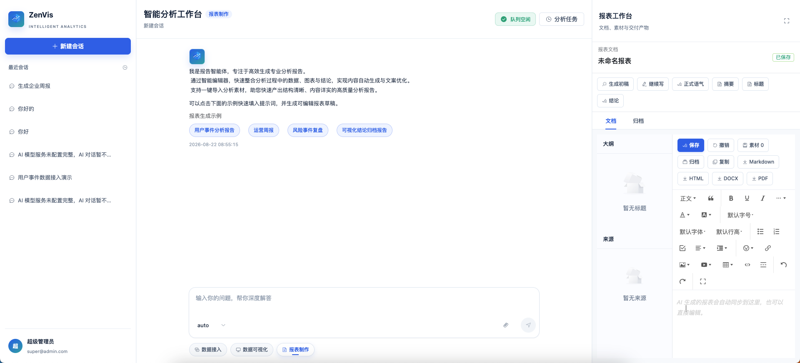
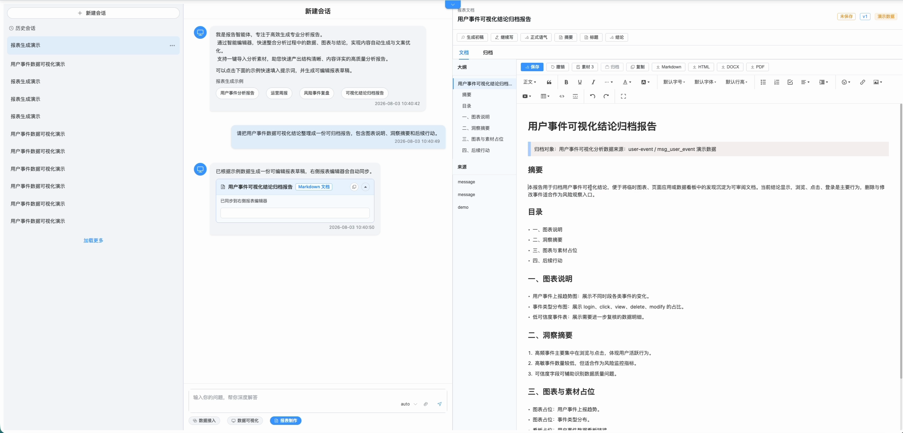
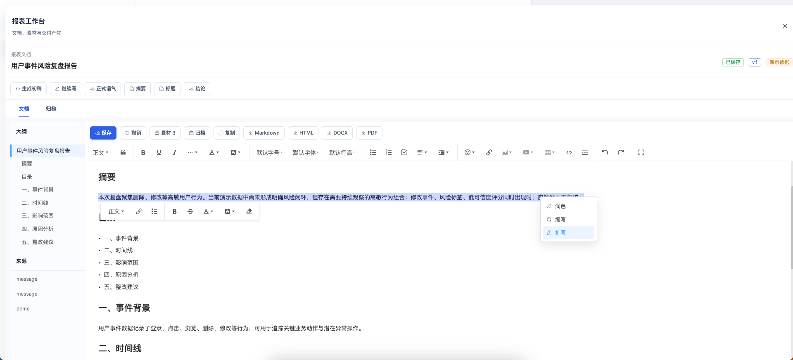

# 报表制作

## 功能定位

报表制作 Agent 将会话、附件和其他分析结果组织为结构化文档，并在右侧工作台中持续编辑、保存、归档和导出。

## 进入方式

进入完整数智中心，在功能入口选择“报表制作”。右侧显示报表编辑器和文档操作区。

## 页面说明

- 对话区负责生成、改写和解释。
- 报表任务使用持久化智能体运行卡，显示计划步骤、当前章节、审批和暂停原因；关闭页面不会取消任务。多轮报表请求各自保留一张任务卡，不会只显示最后一轮。
- 运行卡的“执行过程”默认折叠，汇总本轮的检索次数、工具调用次数和上下文压缩次数；展开后可查看 RAG 查询范围与来源、MCP 输入/返回/耗时，以及压缩前后的 Token 和摘要。
- 运行卡进入“等待补充信息”时自动弹出完整问题；提交内容后通过 steer 继续原任务，选择“稍后处理”后可从卡片重新打开。
- 右侧编辑器保存当前 Markdown 或 HTML 正文。
- 快捷操作支持继续写、摘要、标题、结论、大纲和全文改写。
- 选区操作只处理当前选中文本。
- 文档可以保存当前状态、归档版本，并导出 Markdown、HTML、DOCX 或 PDF。

## 操作前检查

- 明确报表读者、统计周期、数据截止时间、必含章节和交付格式。
- 上传材料前统一文件版本，移除重复或过期附件，并确认敏感信息处理要求。
- 对正式报告先约定数据来源和审核人，AI 生成内容不能替代事实审核。

## 核心操作

1. 进入“报表制作”，填写清晰的报表标题，并在对话中说明读者、范围、章节和语气。
2. 上传或引用材料，检查右侧“来源/素材”数量与预期一致。
3. 点击“生成初稿”，等待任务按“先大纲、再逐章节写入”的方式同步到右侧编辑器；先核对标题、章节和关键数据，再调整措辞。

长报表由平台受控工具分章节持久化。单章节目标约 1,200 个中文字符，硬上限 2,400 字符；每写入一章立即保存草稿，因此后续章节失败不会丢失已完成内容。

4. 使用“继续写、摘要、标题、结论”等快捷操作，或选中需要补充的段落后执行 AI 扩写；提交前确认作用范围是选区而非全文。

5. 在大纲和来源区域逐章检查结构，并确认每项数据或材料可追溯。
6. 每轮重要修改后点击“保存”；需要保留里程碑时执行“归档”。
7. 导出前检查标题、日期、引用、表格、敏感字段和审批结论，再选择支持的导出格式。

## 结果确认

- 页面显示“已保存”，重新打开会话后正文、标题和来源仍存在。
- 归档页能找到关键版本，导出文件可打开且没有截断、乱码或样式错位。
- 正式交付版本已经由业务负责人核对数据与结论。

## 权限与约束

- Agent 只处理当前会话可访问的内容和附件。
- 完整生成或全文改写会生成新的整篇修订；修改类请求先定位受影响章节，只重写目标章节。选区操作仍只替换选中片段。
- 分章节写入的当前步骤受模型输出上限约束；提高上限只能降低截断概率，不能替代章节化写入。
- 当前步骤被截断时会先重试该步骤，连续失败后任务暂停；半截章节不会提交，其他已完成章节保留。
- 导出前应人工核对事实、数据、结论和敏感信息。
- 归档用于保存版本，不替代外部正式文档审批流程。

## 存储与版本

- 右侧正在编辑的正文以 MySQL 为权威存储；每次点击“保存”都会生成可恢复的修订记录。
- 正式修订正文和导出的 DOCX/PDF 保存在 MinIO 的 `zenvis-reports` Bucket。相同修订、内容、标题、格式和导出器版本再次导出时复用同一对象。
- 归档恢复、导出和素材读取都依赖对应修订对象。对象缺失时页面会返回明确错误，不会用旧 MySQL 正文或其他修订替代。
- 本次存储迁移不回填历史报表修订。迁移前已归档但缺少新对象布局的版本不可直接恢复或导出，需要重新生成修订。

## 常见问题

### 回答已生成但右侧没有正文

确认本次回答包含报表文档结果；普通聊天文本不会自动覆盖右侧编辑器。

### 选区改写作用到了全文

重新选择目标文字后使用选区快捷操作，不要发送“重写整篇”类指令。

### 提示“报表输出被截断”

这表示模型没有写完当前步骤或当前章节。先在任务运行卡中确认暂停原因，再缩短当前章节、拆分内容或缩小范围后继续；不要要求模型重新输出整篇报表。

如果旧运行模式被显式关闭，系统会回退到单次完整围栏输出。此时仍可能因 `finish_reason=length` 或围栏未闭合而丢弃正文，应优先恢复持久化 Agent Run。

### 知识库检索显示“已跳过”

展开“知识库检索”查看原因。报表 Skill 未绑定知识库时会显示“已跳过 · 0 个来源”，这是检索范围为空，不影响已配置 MCP 工具继续执行。若期望使用知识库资料，应先在 Skill 管理页绑定并构建知识库。

### 归档恢复或导出提示对象不存在

对应修订正文未写入 `zenvis-reports`，或对象已被清理。该版本不可继续恢复或导出；请从当前正文重新保存并归档。不要通过清空数据库或删除其他修订规避错误。

## 关联功能

- [知识问答](/01-产品理念与使用/数智中心/知识问答.md)
- [数据可视化](/01-产品理念与使用/数智中心/数据可视化.md)
- [AI 分析任务](/01-产品理念与使用/数智中心/AI分析任务.md)
