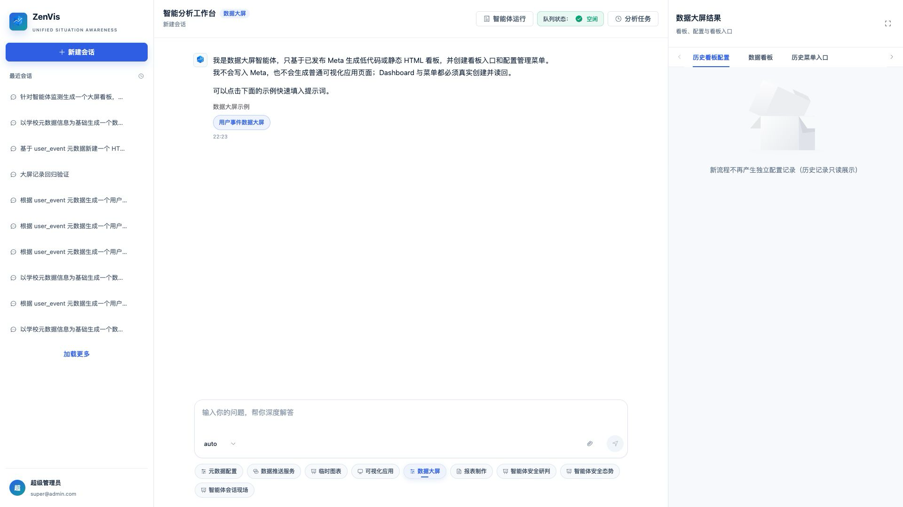
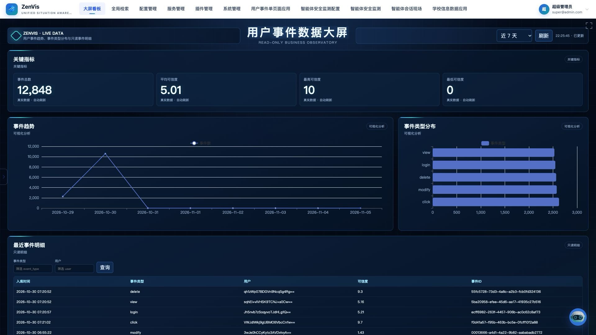

# 数据大屏智能体

## 功能定位

数据大屏智能体把业务主题转换为只读数据大屏。模型只输出 `DashboardSpec` 或 `DashboardChangeSet`，HTML、AMIS、API 路径、渲染脚本、配置文件和 Dashboard 记录全部由服务端确定性编译、校验、预览和发布。

默认生成深色科技风静态 HTML 大屏；只有用户明确要求低代码时才使用 `LOW_CODE_PAGE` 兼容模式。两种模式使用同一份规格、同一套 Meta 校验和真实查询取样，不写入临时图表库，也不创建菜单。

## 进入方式

打开智能分析工作台，在底部能力入口选择“数据大屏”。右侧“数据大屏结果”保留三个页签：

- “历史看板配置”：历史记录只读展示，新流程不再产生独立配置成功记录。
- “数据看板”：展示发布后的真实 Dashboard 记录。
- “历史菜单入口”：历史菜单记录只读展示，新流程不调用任何 `menu_*` 工具。

发布后通过现有看板抽屉进入大屏，不修改系统导航或菜单权限。



## 操作前检查

- 目标实体、字段、时间字段和查询工具已经存在于已发布 Meta。
- 用户已确认大屏主题、实体范围、指标口径、图表类型和明细字段。
- 修改已有大屏时，已读取当前清单、版本、规格摘要和文件摘要。
- HTML 与低代码模式在首次发布后锁定；切换模式必须使用新的 `dashboard_id` 新建。

缺少 Meta、实体或字段时立即停止，不调用写工具。缺失卡提供“前往元数据配置”深链，只预填提示词，不自动发送或自动调用其他智能体。

## 默认规格

新建大屏默认值：

| 字段 | 默认值 |
| --- | --- |
| `mode` | `HTML_PAGE` |
| `theme` | `DARK_TECH` |
| `refresh_interval_seconds` | `60` |
| `default_time_range` | `LAST_7_DAYS` |

时间筛选首版支持 `LAST_24_HOURS`、`LAST_7_DAYS`、`LAST_30_DAYS`、`THIS_MONTH` 和 `ALL_TIME`，不开放自定义日期区间。

规格包含：

- 12 列响应式布局；每个区块通过 `block_id` 与 `span` 引用，单行跨度合计不得超过 12。
- `metrics` 区块绑定 `entity_overview` 或 `entity_summary`，包含 1–8 个 KPI。
- `chart` 区块绑定 `entity_trend`、`entity_distribution`、`entity_aggregate`、`entity_histogram` 或 `entity_scatter`。
- `records` 区块绑定 `entity_list` 语义的只读明细，支持展示、分页和筛选，不允许新增、编辑或删除。

模型不得生成 HTML、CSS、JavaScript、AMIS 节点、API URL、adaptor、SQL、配置文件正文或菜单参数。

## 核心流程

```text
DASHBOARD_DISCOVERY
  → 读取受管大屏、清单、版本和已发布 Meta
  → DASHBOARD_PLAN_CONFIRMATION
  → 输出完整 DashboardSpec 方案卡
  → 用户确认
  → DASHBOARD_VALIDATING
  → visualization_dashboard_validate
  → 真实数据预览与用户确认
  → DASHBOARD_APPLYING
  → visualization_dashboard_apply
  → VERIFIED
```

### 发现与方案

用户只描述主题时，智能体先读取实体和字段 Meta，自动推荐实体、指标、图表、布局和时间口径，然后输出一张完整方案卡。方案卡必须包含大屏 ID、名称、模式、主题、时间字段、默认范围、区块和布局；用户确认后才进入校验。

### 校验与预览

`visualization_dashboard_validate` 执行以下只读检查：

- 按已发布 Meta 校验实体、字段、时间字段、图表工具、查询组合、布局跨度和区块数量。
- 对每个唯一查询执行一次真实只读查询；空结果是警告，查询失败或字段不存在是阻断。
- 将同一份 Spec 编译为 HTML 或 AMIS，并生成版本、规格、Meta、文件和验证摘要。
- 生成用户、会话、工作流和一次性令牌绑定的真实 iframe 预览，默认 30 分钟有效。

预览卡展示真实数据、区块取样、文件摘要、诊断和“确认发布大屏”操作。卡片由服务端确定性收口：即使模型只返回正文，服务端也会根据成功的 `visualization_dashboard_validate` 结果或当前锁定工作流补全 `validationStatus=validated`、`passed=true`、摘要、预览地址和允许动作；模型输出不完整或摘要不一致的卡片会被替换。卡片 ID 稳定且不超过 64 字符，完整摘要保留在元数据中。

用户必须点击“确认发布大屏”并完成二次确认。聊天框输入“确认发布”等文字不构成卡片动作，不能替代真实预览确认。预览失败、过期、跨用户或跨会话时必须重新校验，不得复用旧摘要。

### 发布与读回

`visualization_dashboard_apply` 只接受工作流锁定的 `workflow_id`、`candidate_digest` 和 `validation_digest`，触发一次 `ASK/HIGH` 审批。平台一次完成：

1. 复核清单版本、规格/文件摘要、Meta 摘要和受管文件漂移。
2. 写入候选配置与清单。
3. 创建或更新稳定 `code=<dashboard_id>`、`source=dashboard:<dashboard_id>` 的 Dashboard。
4. 全量读回配置、清单和 Dashboard 身份字段。
5. 任一步失败时恢复旧配置与 Dashboard，不产生半成功状态。

发布不调用 `menu_*`，不改变用户默认看板，也不覆盖无清单历史大屏。

发布成功后的记录卡按真实 `dashboard_id` 和锁定的 `applyResult` 关联对应的 `VERIFIED` 工作流，不依赖当前 `activeByAgent`。即使活动工作流已因完成而清理，也不会新建 `BLOCKED` 工作流或把成功发布显示成失败。

## 存储约定

| 模式 | 内容文件 | 清单 | Dashboard 类型 |
| --- | --- | --- | --- |
| HTML | `html-page_config/<dashboardId>.html` | `html-page_config/<dashboardId>.manifest.json` | `HTML_PAGE` |
| 低代码 | `<dashboardId>_config/index.json` | `<dashboardId>_config/_dashboard.json` | `LOW_CODE_PAGE` |

清单保存完整 Spec、版本、模式、规格/Meta/文件摘要、已发布文件、Dashboard 记录 ID 和发布状态。无清单的历史 HTML、低代码目录或 Dashboard 记录只读展示，不会被新流程自动接管。

## 大屏运行时

HTML 模板提供顶部品牌与标题、全局时间筛选、KPI 卡片带、主图表区、辅助图表和只读明细表。运行时：

- 使用同源、固定版本的 ECharts 文件，不依赖 CDN。
- 默认每 60 秒自动刷新，支持手动刷新和全局时间范围切换。
- 每个区块独立加载，单区块失败不会清空其他区块。
- 空数据、加载中和错误状态可见，不使用虚构值或演示数组。
- 所有标题、标签和明细内容都转义；查询工具、API 路径和脚本只来自白名单编译器。



首版只提供一套经过打磨的深色科技设计系统，不开放任意主题或自定义 CSS。

## 修改已有大屏

1. 调用 `visualization_dashboard_get` 读取清单、Spec、版本、规格摘要和文件摘要。
2. 生成包含 `base_dashboard_version`、`base_spec_digest`、`base_file_digest` 和完整新 Spec 的 `DashboardChangeSet`。
3. 重新校验并生成新的真实预览。
4. 版本、摘要、Meta 或受管文件漂移时阻断，要求重新读取；不得强行覆盖。

## 权限与约束

- Skill 只允许 retrieval 只读元数据/查询工具和 `visualization_dashboard_list/get/validate/apply`。
- 不包含 `config_*`、`dashboard_create`、`dashboard_view`、`menu_*`、`push_task_*` 或 Meta 写工具。
- 发布审批只控制 `visualization_dashboard_apply`，不能替代方案确认或真实预览确认。
- 大屏只读系统数据；明细区不提供任何写操作。

## 常见问题

### 校验失败或没有预览

查看 `diagnostics` 中的 `code/path/message`。字段不存在、查询失败和布局越界会阻断；空结果只有警告，可通过空态发布。摘要过期或服务重启后必须重新校验。

正常情况下，校验成功即使模型没有输出结构化预览卡，平台也会自动补全完整卡片。旧会话中的历史消息不会追溯补卡；刷新会话并重新执行校验即可生成新预览。不要通过聊天输入“确认发布”绕过卡片。

### 发布被阻断

常见原因是大屏版本或文件被其他操作修改、Meta 已变化、模式在首次发布后变更、Dashboard code 被其他记录占用。重新读取清单后再生成方案，不要复用旧确认卡。

### 老看板无法修改

无清单的历史大屏按只读兼容处理，新流程不会自动接管或覆盖。如需受管大屏，请使用新的 `dashboard_id` 新建。

### 大屏没有菜单入口

这是预期行为。新流程通过现有看板列表进入；历史菜单记录只读展示。

### 打开分享链接提示“低代码页面配置无效”

优先检查链接中的 `id` 是否指向刚发布的 `HTML_PAGE` 看板。看板允许同名记录存在，入口会先按 `id`、再按 `code`、最后按唯一名称匹配；只有同名记录不唯一时才回退默认看板。若链接误指向旧低代码看板，使用 `#/dashboard/index?id=<Dashboard ID>&code=<dashboard code>` 打开，并在看板列表中确认类型为 `HTML_PAGE`。

## 关联功能

- [元数据配置智能体](/01-产品理念与使用/数智中心/元数据配置智能体.md)
- [临时图表智能体](/01-产品理念与使用/数智中心/临时图表智能体.md)
- [可视化应用智能体](/01-产品理念与使用/数智中心/可视化应用智能体.md)
- [大屏看板](/01-产品理念与使用/大屏看板.md)
- [看板管理](/01-产品理念与使用/系统管理/看板管理.md)
- [数据大屏 MCP 工具](/08-API参考/MCPtool/数据大屏工具.md)
