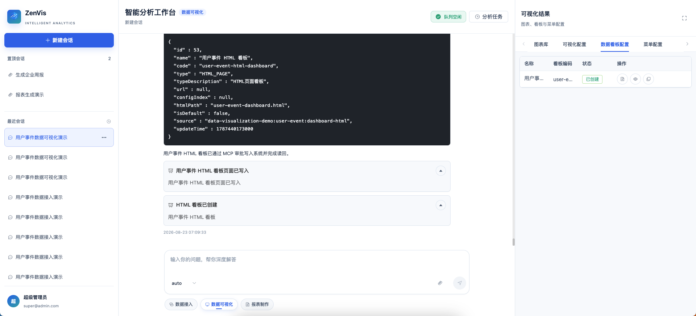
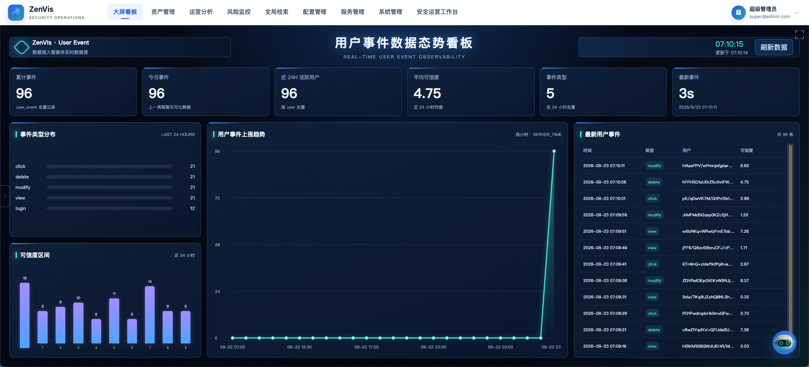

# 数据大屏智能体

## 功能定位

数据大屏智能体基于已发布 Meta 查询真实数据，生成低代码或静态 HTML 看板，完成 Dashboard 创建与读回，并按需发布配置管理菜单。它不生成普通可视化应用配置，也不写入临时图表库。

## 进入方式

进入完整数智中心，在功能入口选择“数据大屏”。右侧工作台分为“看板配置”“数据看板”和“菜单入口”三个页签。

## 操作前检查

- 目标实体、字段和时间口径已发布并完成真实查询验证。
- 明确看板名称、code、低代码或 HTML 类型、目标配置和菜单入口。
- 确认看板是否需要默认打开，以及同名或同 code 看板的冲突处理。

缺少 Meta、实体或字段时立即停止，不调用写工具。缺失卡提供“前往元数据配置”深链，只预填提示词，不自动发送或自动调用其他智能体。

## 核心流程

```text
实现方式确认
  → 实体 Meta
  → 字段 Meta
  → 查询方案确认
  → 真实数据查询
  → 完整看板配置
  → 写入确认 / 覆盖确认
  → config_apply
  → config_read
  → dashboard_create
  → dashboard_view
  → 配置与看板成功记录
  → 可选菜单确认
  → menu_create / menu_view
  → 菜单成功记录
```

1. 选择低代码或静态 HTML 看板实现方式。
2. 核对实体、字段、查询方案和看板布局。
3. 确认完整配置、目标文件和 Dashboard 参数。



4. 平台按锁定方案执行配置写入与读回，再完成 Dashboard 创建与读回；读回字段不一致时阻断。
5. 需要配置管理入口时单独确认菜单，不新增看板专用 MenuType。



## 结果确认

- 配置记录通过 `recordKind=config` 写入 `visualizationDashboard.configs`。
- Dashboard 记录通过 `recordKind=dashboard` 写入 `visualizationDashboard.dashboards`。
- 菜单记录通过 `recordKind=menu` 写入 `visualizationDashboard.menus`。
- Dashboard 名称、code、类型、configIndex 和来源必须与已批准参数一致。
- 查询数据只用于生成看板，不进入临时图表库，也不输出可视化应用记录。

## 权限与约束

- 允许 retrieval、配置工具、`dashboard_create/dashboard_list/dashboard_view` 和 `menu_*`。
- 不包含 `push_task_*` 或 Meta 写工具。
- 已存在同名或同 code 但内容不同的 Dashboard 时阻断，不覆盖、不重复创建。
- 配置、Dashboard 或菜单参数变化后必须重新生成确认卡；菜单确认拒绝时保留已成功的配置与看板。

## 常见问题

### 看板创建后没有记录

检查 `config_read`、`dashboard_create`、`dashboard_view` 和审批结果，读回字段不一致时不会生成成功记录。

### 菜单入口打不开

确认菜单路由、参数和看板 configIndex 一致，并检查角色权限。

## 关联功能

- [元数据配置智能体](/01-产品理念与使用/数智中心/元数据配置智能体.md)
- [临时图表智能体](/01-产品理念与使用/数智中心/临时图表智能体.md)
- [可视化应用智能体](/01-产品理念与使用/数智中心/可视化应用智能体.md)
- [大屏看板](/01-产品理念与使用/大屏看板.md)
- [看板管理](/01-产品理念与使用/系统管理/看板管理.md)
