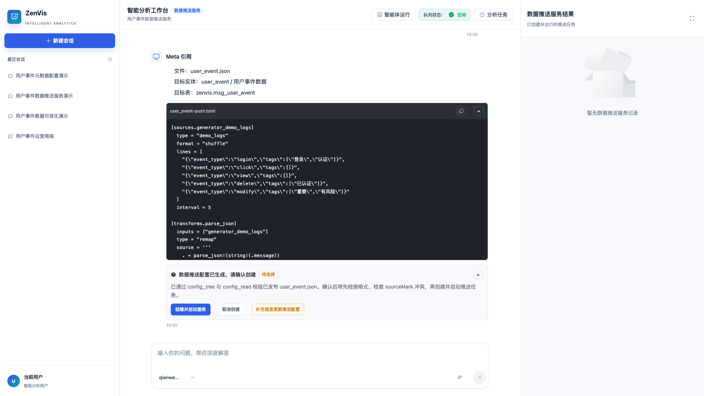

# 数据推送服务智能体

## 功能定位

数据推送服务智能体只负责基于已发布 Meta 生成、创建、诊断和修复 PushTask/Vectum 数据推送服务。Meta 对它始终只读，它不会建表、写 Meta 或修复 Meta。

它唯一的业务输入依赖是已发布 Meta 的只读契约。缺失 Meta 时流程停止，并提供“前往元数据配置”入口；不会自动调用元数据配置智能体。

## 进入方式

进入完整数智中心，在功能入口选择“数据推送服务”。右侧“数据推送服务结果”只展示本次会话创建并验证过的推送任务。

## 页面说明



- 中间对话区用于描述数据来源、输入格式、解析映射、目标实体和推送规则。
- 右侧面板只归集推送任务记录，可打开对应低代码任务详情。
- 演示使用部署中已有的 `user_event.json`，先执行真实只读校验，再创建推送任务。
- 创建和修复使用真实 MCP 审批、状态读回和 system 日志验证。

## 操作前检查

- 先在元数据配置智能体完成并发布目标 Meta，确认实体和字段可读。
- 准备数据源类型、输入格式、样例、字段映射、目标实体和稳定 `sourceMark`。
- 不要把真实密码、Token 或 Cookie 写入对话；凭据应通过部署环境变量管理。
- 目标表不存在或 Meta 不可读时，应回到元数据配置处理，不能在推送流程中伪造 Meta。

## 核心操作

1. 新建“数据推送服务”会话，选择或填写已发布 Meta 文件名，并描述数据来源与推送目标。
2. 平台只读执行 `config_tree(type="meta")` 和 `config_read`，锁定 `metaRef` 内容摘要。
3. 审阅完整推送配置。确认卡必须包含 `metaRef`、稳定 `sourceMark`、完整请求、校验状态、错误路径/修复建议、测试通过数和修复轮次。
4. 配置测试通过但平台门禁未通过时，卡片显示“门禁未通过”并逐项列出阻断原因；此时不会显示“创建并启动服务”。
5. 阻断卡可点击“重新校验并继续”。平台只使用已锁定候选重新读取 Meta 和执行校验，不会直接创建、更新或启动任务；重新校验通过后会生成新的确认卡。
6. 只有新确认卡候选、Meta、`validationDigest`、工具证据全部通过后，才显示“创建并启动服务”；批准后平台仍会再次校验并比对摘要。
7. 依次执行 `sourceMark` 冲突检查、创建或复用、配置与任务身份读回、当前 `runId` 运行诊断。
8. 若 Meta 在确认后发生变化，平台要求重新生成并确认推送配置，不静默沿用旧方案。
9. 任务真实存活且本轮日志无 `ERROR/FATAL/PANIC` 时，才生成数据推送服务成功记录；记录显示真实 `taskId`、`runId`、校验摘要、测试和本轮日志摘要。

## 缺失 Meta 与跨入口

```zenvis:data-push-service-decision
{"kind":"missing_meta","handoff":{"targetAgentType":"agent_metadata_config","label":"前往元数据配置","prompt":"请为 user_event.json 创建并发布 Meta 配置：实体 user_event（用户事件数据），目标表 zenvis.msg_user_event，字段包括 event_id、user、event_type、detail、tags、server_time。"}}
```

- 缺失 Meta 时，不调用任何 `push_task_*` 写工具，也不调用 `config_add/config_apply`。
- 前端通过新会话深链打开元数据配置入口，只预填缺失实体、表名和字段需求。
- 预填提示词不会自动发送，用户仍需检查并主动发送。
- 数据推送服务与其他智能体没有 Agent 间自动调用，也不串联执行。

## 状态机

```text
PUSH_INPUT_COLLECTION
  → Meta 只读校验
  → push_task_validate_config
  → PUSH_PLAN_CONFIRMATION；阻断时 retry 重新校验锁定候选（不创建）后生成新确认卡
  → 用户确认
  → PUSH_CONFIG_VALIDATION
  → push_task_list(sourceMark, source=SYSTEM)
  → push_task_get（已有任务时）
  → push_task_create_and_start 或 push_task_update_and_restart
  → 配置与任务身份读回
  → push_task_diagnose（当前 runId）
  → 成功记录或阻塞
```

- 工具白名单包含 `config_tree`、`config_read` 和 11 个 `push_task_*` 工具，不包含 `config_add/config_apply`。
- 配置格式由候选和工具参数显式传递；不再调用格式检测工具。
- 查询工具可读取全部来源任务；创建固定 `source=SYSTEM`，`source + mark` 只用于创建幂等。
- 同一 `sourceMark` 存在多个任务时停止，不猜测目标。
- 创建响应异常后先用 `push_task_list` 和 `push_task_get` 按 `sourceMark` 读回，避免重复创建。
- 自动修复最多 5 轮，每一轮都必须有当前 `runId` 的本轮日志证据；相同失败再次出现立即停止。
- 网络、认证、DNS、TLS、权限、目录和密钥等外部阻塞直接阻塞，不进行无证据改配置。
- 校验接口不可用时按 fail-closed 停止，不能跳过校验强制创建。

## 结果确认

- 右侧“数据推送服务结果”出现任务记录，并可打开任务详情。
- 任务状态为运行中，真实 `taskId`、当前 `runId` 和唯一 `sourceMark` 与平台读回一致。
- 记录展示校验摘要、测试通过数、修复轮次和本轮脱敏日志摘要。
- 本轮日志无 `ERROR/FATAL/PANIC`；样例数据的数量、字段和时间与源数据一致。

## 常见问题

### 提示缺少已发布 Meta

检查目标 Meta 是否存在、实体和字段是否齐全；使用缺失 Meta 卡中的“前往元数据配置”完成发布后，再回到推送入口。

### 创建出重复任务

检查 `sourceMark` 是否稳定，以及创建异常后是否先执行按 `sourceMark` 读回。

### 任务存在但没有数据

检查 Vectum、Kafka、源地址、解析映射、ClickHouse、Sink 和 DLQ 配置。

### 门禁未通过时为什么没有“创建并启动服务”

配置测试通过只代表候选本身可用，不代表平台门禁允许写入。卡片会继续核对候选摘要、Meta 引用、`validationDigest`、`sourceMark` 和校验工具回执；任一项不一致或缺少成功证据时，只提供“重新校验并继续”和“补充信息更新推送配置”。先按卡片列出的阻断项重新校验，通过并生成新确认卡后，才会出现“创建并启动服务”。

### 提示“卡片版本已过期”

该提示表示提交的卡片版本与当前交互不一致，常见原因是页面仍保留旧卡、Run 已被重新排队，或前端请求没有正确携带 `stateRevision`。先刷新会话并从最新卡片重新操作；如果最新卡片仍持续报错，应检查统一交互请求是否发送了当前 `pendingInteraction.stateRevision`，不要重复点击旧卡或改用普通消息绕过校验。

## 关联功能

- [元数据配置智能体](/01-产品理念与使用/数智中心/元数据配置智能体.md)
- [数据推送服务](/01-产品理念与使用/服务管理/数据推送服务.md)
- [MCP 服务](/01-产品理念与使用/系统管理/MCP服务.md)
