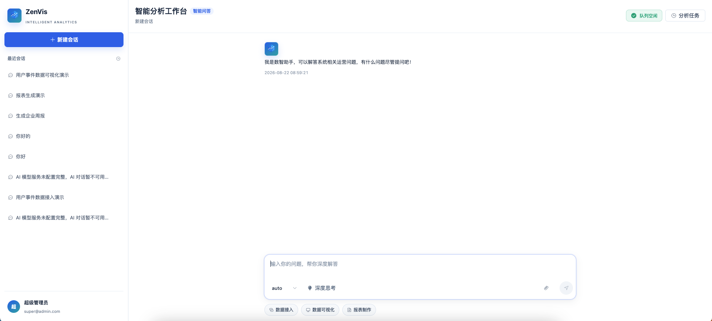
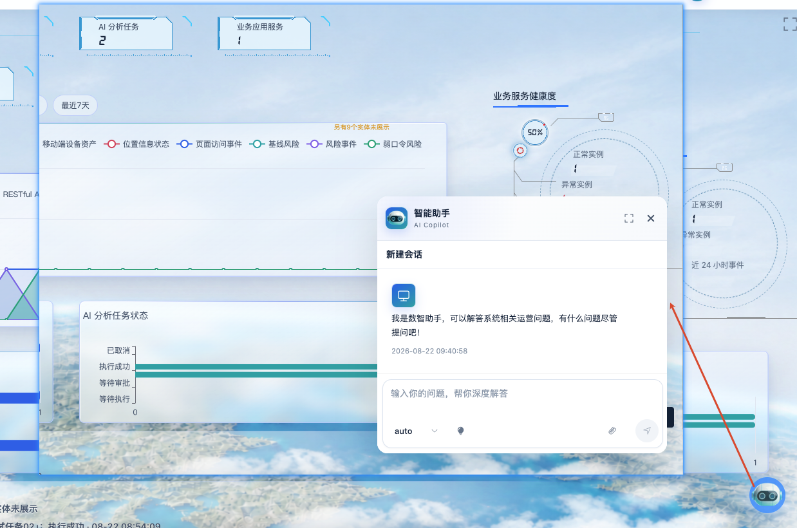

# 知识问答

## 功能定位

知识问答通过“智能助手”提供带会话记忆的自然语言交流入口，可结合平台 RAG 知识库回答产品、业务和使用问题。它既可以在独立页面使用，也可以从任意业务页面打开悬浮窗口。

## 进入方式

点击页面右下角智能助手浮球打开悬浮窗口，或在顶部导航进入 **数智中心 → 智能助手** 打开独立对话页面。

## 页面说明

- 独立页面用于开始完整会话，并提供元数据配置、数据推送服务、临时图表、可视化应用、数据大屏和报表制作等能力入口。
- 对话头部操作区提供“智能体运行”入口，与队列状态和分析任务并列；左侧会话栏只保留新建会话和会话列表。
- 悬浮窗口覆盖在当前业务页面之上，适合边查看页面边追问，不会强制离开当前操作。
- “深度思考”是知识问答的可选模式，会展示单独的思考状态。
- 文本附件会在限制长度内加入上下文；图片会发送给支持视觉能力的模型。

## 操作前检查

- 明确问题范围和期望输出，例如“给出三步操作并引用产品文档”，比泛泛提问更容易得到可核验结果。
- 涉及内部材料时先确认文件可以在当前会话中使用，并移除密码、密钥和个人敏感信息。
- 需要查询业务实体或执行系统动作时，改用对应业务 Agent；知识问答本身不调用 MCP。

## 核心操作

1. 从独立对话页选择知识问答，或点击页面右下角浮球打开智能助手悬浮窗口。

2. 新建会话，在输入框说明背景、问题、输出格式和限制条件；附件上传完成后再发送。
3. 从模型下拉框选择可用模型；复杂分析可启用深度思考。
4. 发送后等待回答完成。流式输出期间不要重复发送同一问题。
5. 检查引用和关键事实，必要时追问“依据是什么”或要求按步骤重写。
6. 对有复用价值的会话改名并置顶；删除前确认其中没有尚未保存的结论。
7. 业务智能体执行时间较长时，从对话头部的“智能体运行”查看进度、审批和运行记录；关闭页面不会停止任务。
8. 多轮业务任务会在各自回复中保留独立的“智能体任务”卡。展开“执行过程”可查看该轮的知识库检索、工具调用和上下文压缩；“等待补充信息”时会自动弹出输入框，提交后继续原任务。

## 结果确认

- 回答与当前会话问题一致，引用内容能够在原文中找到。
- 附件出现在消息中且状态正常；只显示文件名不代表内容已解析。
- 涉及日期、版本、统计值和操作建议时，使用系统页面或权威来源二次核对。

## 权限与约束

- 普通知识问答不调用 MCP 工具，也不执行系统写入。
- 普通知识问答不创建持久化 Agent Run；智能体任务中心记录的是元数据配置、数据推送服务、临时图表、可视化应用、数据大屏和报表制作等业务 Agent 的运行。
- RAG 只有在向量能力和文档已就绪时生效。
- 不支持解析的附件只会向模型提供文件名、大小和类型。
- 模型、上下文窗口和附件大小受部署配置限制。

## 常见问题

### 回答没有引用平台文档

检查 RAG 知识库是否已初始化、文档是否已加载，以及当前模型是否配置了 embedding。

### 附件内容没有被读取

确认文件类型受支持且未超过限制；二进制文件不会自动解析为文本。

### 关闭页面后业务任务是否继续

会继续。业务 Agent 的持久化任务由后端调度器执行；重新打开原会话后，系统会恢复活动任务和事件游标。只有点击“停止”才会取消任务。

## 关联功能

- [RAG 文档管理](/01-产品理念与使用/系统管理/RAG文档管理.md)
- [元数据配置](/01-产品理念与使用/数智中心/元数据配置智能体.md)
- [数据推送服务](/01-产品理念与使用/数智中心/数据推送服务智能体.md)
- [临时图表](/01-产品理念与使用/数智中心/临时图表智能体.md)
- [可视化应用](/01-产品理念与使用/数智中心/可视化应用智能体.md)
- [数据大屏](/01-产品理念与使用/数智中心/数据大屏智能体.md)
