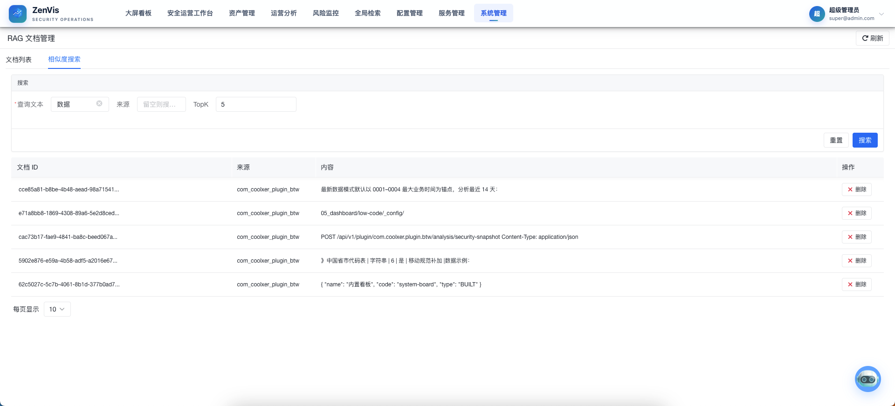

# RAG 文档管理

## 功能定位

RAG 文档管理用于管理数据集与知识库的生命周期：维护 Markdown 文件存储、触发向量化构建、验证检索结果并执行必要的刷新或清理。它面向知识库运维，不等同于日常知识问答页面。

## 进入方式

使用具备系统管理权限的账号登录，依次进入 **系统管理 → RAG 文档管理**。

## 页面说明

页面通过「数据集管理」、「知识库管理」和「相似度搜索」三个页签组织运维工作，页面顶部提供「检索记录」全局入口：

- **数据集管理**：创建数据集，向数据集中上传 Markdown 文件（单文件、多文件或整个目录），查看文件列表与内容，删除不再需要的文件。目录上传保留原有层级结构，适合批量维护已有分类的文档。
- **知识库管理**：创建知识库并关联一个或多个数据集，执行构建将 Markdown 文件向量化写入 Redis 向量库；查看构建日志与当前知识库已入库的文档列表；编辑或删除知识库。
- **相似度搜索**：输入查询文本并设置 `TopK`，验证当前向量索引返回的候选内容质量。
- **检索记录**：页面顶部按钮，审计每次检索的请求与结果，覆盖管理端搜索和问答两种来源。

## 操作前检查

- 确认文档来源、授权范围、更新时间、编码和敏感信息处理要求。
- 更新前准备 3～5 个代表性问题和期望命中文档，作为回归用例。
- 删除或重建索引前确认影响范围和恢复来源。

## 核心操作

### 数据集管理

1. **创建数据集**：点击「创建数据集」，填写名称、来源、标签和描述。数据集创建后不可修改目录位置，名称和描述可随时编辑。
2. **上传文件**：在数据集列表操作列点击「上传文件」，选择一个或多个 `.md` 文件。文件直接存入 MinIO，上传成功后自动刷新文件数。
3. **上传目录**：在数据集列表操作列点击「上传目录」，选择本地文件夹。系统会自动扫描文件夹下所有 `.md` 文件，按原层级结构上传到该数据集。例如选择 `docs/guide/` 目录，`docs/guide/intro.md` 会被存储为 `guide/intro.md`。
4. **文件列表与内容**：点击「文件列表」查看该数据集下所有文件，支持预览内容、按层级路径确认目录结构，并删除单个文件。
5. **删除数据集**：删除前请确认该数据集未被任何知识库引用。已引用的数据集无法删除。

### 知识库管理

1. **创建知识库**：点击「创建知识库」，填写名称、来源、标签、描述，并至少关联一个数据集。一个知识库可关联多个数据集，构建时会同时处理。
2. **构建**：在知识库列表操作列点击「构建」。构建过程会读取关联数据集中的 Markdown 文件，切分后通过向量模型写入 Redis 向量库。构建为异步任务，弹窗中会实时显示日志进度；构建完成后点击「完成」关闭弹窗。
3. **查看文档**：在知识库列表操作列点击「文档」，弹出该知识库已入库的向量文档列表。可通过关键词或来源进一步筛选，查看文档内容、元数据，或删除单条向量文档。删除向量文档不会影响数据集原始文件。
4. **编辑与删除**：编辑知识库可修改名称、来源、标签、描述或调整关联的数据集。删除知识库会同时清理 Redis 向量库中的相关文档。

### 相似度检索

切换到「相似度检索」页签，输入具有代表性的查询文本，限定来源并调整 `TopK`，点击搜索观察召回结果。命中文档会显示来源、文件名、内容片段和相似度得分，用于验证索引质量。

### 检索记录

点击页面顶部「检索记录」，查看每次检索的审计日志，包括管理端搜索（类型「管理端」）和知识问答触发的检索（类型「问答」）：

- 列表展示时间、类型、知识库 ID、检索文本、TopK、命中数、状态、耗时和错误信息，可按知识库 ID、检索文本、类型和状态筛选。
- 状态含义：`成功` 表示有命中，`no_match` 表示检索正常但无命中，`empty_query` 表示查询文本为空，`retrieval_error` 表示检索异常（错误信息列有详情）。
- 点击「详情」查看完整检索文本和命中结果 JSON（含知识库、数据集、文件名和内容片段）。
- 全局搜索产生的记录按命中文档数最多的知识库归属；旧文档若未重新构建（缺少知识库元数据），其检索记录可能没有知识库归属。

排查「搜索无结果」时，先到检索记录中确认该次搜索的状态：`no_match` 说明向量库无相似内容（可能需要重新构建知识库），`retrieval_error` 说明向量库或向量模型异常。

## 结果确认

- 文档名称、来源、更新时间和内容摘要与上游一致。
- 代表性问题在合理 `TopK` 下命中正确片段，旧版本内容不再出现。
- 知识问答能够引用新内容，且引用指向可核验来源。

## 权限与约束

- 文档刷新和删除会改变知识库状态，仅授权管理员可以执行。
- 数据集名称和知识库名称各自唯一（仅统计未删除的记录）：创建或编辑为重名时会提示「名称已存在」，需换一个名称；删除旧记录后其名称可以复用。
- 页面展示的是进入索引后的文档信息；文档如何产生或同步取决于上游来源和部署配置。
- 知识库不应收录密码、密钥、个人敏感信息或未经授权的数据。
- 检索命中只代表内容相关，不代表答案一定正确，仍需结合来源判断。

## 常见问题

### 文档已更新，为什么问答仍引用旧内容？

检查数据集文件是否已重新上传，然后重新执行知识库构建，再通过检索测试确认新内容已经进入候选结果。

### 检索不到明确存在的内容怎么办？

确认文档确实已被索引（先通过知识库「文档」查看入库列表），尝试使用更接近原文的关键词并适当提高 `TopK`；如仍无结果，检查文档切分和元数据。

### 数据集可以删除但知识库删除不了？

数据集被知识库引用时无法删除。如需删除数据集，先到「知识库管理」中将引用该数据集的知识库编辑为不关联此数据集，或删除该知识库，再回到「数据集管理」执行删除。

## 关联功能

- [知识问答](../数智中心/知识问答.md)：使用已索引知识完成对话。
- [Skill 管理](./Skill管理.md)：管理 AI 处理知识任务时使用的能力。
- [MCP 服务](./MCP服务.md)：管理知识工作流可能调用的外部工具。
