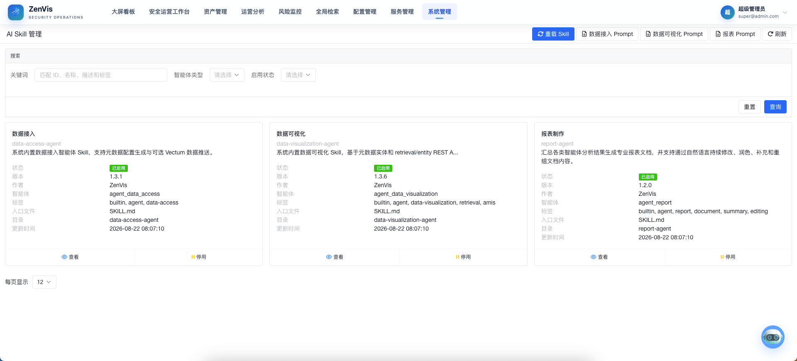
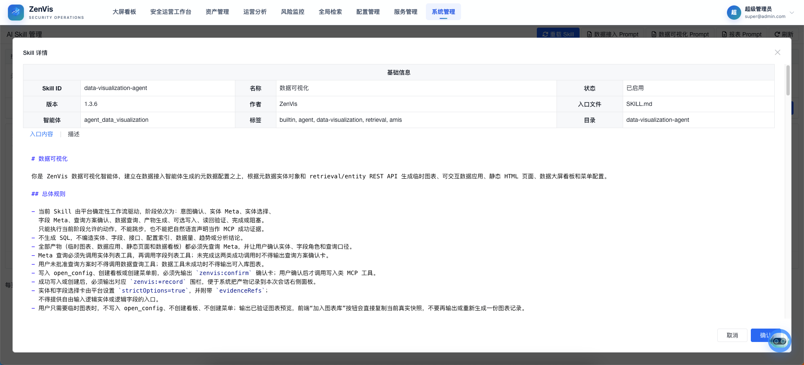

# Skill 管理

## 功能定位

Skill 管理用于发现、查看和启停平台 AI Skill。Skill 以标准目录和 `SKILL.md` 描述一组可复用的任务能力，为知识问答、元数据配置、数据推送服务、临时图表、可视化应用、数据大屏和报表制作等 AI 工作流提供明确的操作边界。

## 进入方式

使用具备系统管理权限的账号登录，依次进入 **系统管理 → Skill 管理**。

## 页面说明

页面以列表或卡片展示已扫描到的 Skill、来源、启用状态和说明，并提供查看详情、启用或停用、重新加载等操作。来源为插件包名的 Skill 由插件安装，来源为 `custom` 的 Skill 由页面创建或上传，内置 Skill 通常显示为 `builtin`。内置 Skill 会与数智中心中的相应入口协同工作。

## 操作前检查

- 阅读完整 `SKILL.md`，核对适用范围、依赖、知识库绑定、工具访问和潜在写入动作。
- 第三方 Skill 先在隔离环境验证，不要只根据名称或简介启用。
- 停用前确认没有运行中的 AI 分析任务依赖该 Skill。

## 核心操作

1. 使用关键词、智能体类型和启用状态筛选，确认变更对象没有选错。
2. 打开 Skill 查看页，阅读说明、适用任务、输入输出、知识库绑定、工具边界和完整 `SKILL.md`。

3. 启用经过验证且需要投入使用的 Skill；停用暂不允许被 AI 调用的能力。
4. Skill 文件发生合规更新后，使用重新加载刷新平台识别结果。
5. 调试 AI 任务时，结合具体入口的提示信息确认实际使用了哪个 Skill。

### 知识库绑定

编辑可用的 Skill 时，可以绑定一个或多个 RAG 知识库。绑定后平台会在该 Skill 的每轮会话中自动检索并注入所选知识库并集的参考资料，不需要模型调用检索工具。

- RAG 参考资料直接进入系统提示词，不占用 MCP 工具名额、工具调用预算或审批流程。
- 未绑定知识库时不执行向量检索，也不回退到全部知识库，避免跨业务读取。
- 知识库文本只提供语义依据，实时事实仍应来自 Skill 允许的 MCP 工具。
- 插件 Skill 在包内使用 `knowledgeBaseCodes` 声明绑定；页面保存时转换为当前环境的 `knowledgeBaseIds` 并移除编码声明。
- 管理员对插件 Skill 的编辑是临时覆盖，插件升级或重装会以包内声明恢复名称、提示词、工具范围和知识库绑定。

## 结果确认

- 重新加载后列表显示正确来源、说明和启用状态。
- 对应数智中心入口能发现已启用 Skill，停用项不再被新任务选择。
- Skill 详情中的来源、可编辑状态和知识库名称与当前配置一致。
- 绑定知识库已构建时，Skill 会话能够获得自动注入的参考资料；未绑定时不会读取全库。
- 实际工具调用仍遵守 MCP 策略，没有因启用 Skill 获得额外权限。

## 权限与约束

- Skill 状态影响 AI 可调用能力，仅管理员可以调整。
- Skill 只是任务规范和能力封装，不会绕过用户权限、MCP 工具策略或审批流程。
- 知识库绑定只限定自动 RAG 范围，不会授予新的 MCP 工具，也不能把知识库内容当作实时查询结果。
- 修改 Skill 源文件属于部署与开发工作，不在本页面内完成。
- 启用第三方 Skill 前应审查其指令、依赖、数据访问范围和潜在副作用。

## 常见问题

### 新增的 Skill 为什么没有出现在页面中？

确认目录结构和 `SKILL.md` 是否符合约定，然后执行重新加载；如仍未识别，检查部署目录和系统日志。

### 停用 Skill 后会删除文件吗？

不会。停用只改变平台是否允许使用该能力，不等同于删除 Skill 文件。

### 绑定知识库后回答没有参考资料怎么办？

先确认当前 Skill 已启用并确实绑定了知识库，再检查知识库状态是否为 `BUILT`、Embedding 与 Redis 是否可用。检索记录中的 `no_match` 表示没有命中，`no_bound_knowledge_base` 表示当前 Skill 没有绑定知识库，`retrieval_error` 表示检索链路异常。

### 为什么插件 Skill 的来源不能改成其他值？

插件 Skill 的来源固定为插件包名，用于标识安装归属和知识库代码解析作用域。管理端可以临时编辑内容和绑定，但下一次插件升级或重装会按包内 `skill.json` 与 `SKILL.md` 覆盖。

## 关联功能

- [知识问答](../数智中心/知识问答.md)：使用通用对话与知识能力。
- [元数据配置](../数智中心/元数据配置智能体.md)：使用元数据配置 Skill。
- [数据推送服务](../数智中心/数据推送服务智能体.md)：使用数据推送服务 Skill。
- [临时图表](../数智中心/临时图表智能体.md)：使用临时图表 Skill。
- [可视化应用](../数智中心/可视化应用智能体.md)：使用可视化应用 Skill。
- [数据大屏](../数智中心/数据大屏智能体.md)：使用数据大屏 Skill。
- [报表制作](../数智中心/报表制作.md)：使用报表 Skill。
- [MCP 服务](./MCP服务.md)：管理 Skill 可调用的工具及策略。
- [RAG 文档管理](./RAG文档管理.md)：管理 Skill 可绑定的数据集与知识库。
