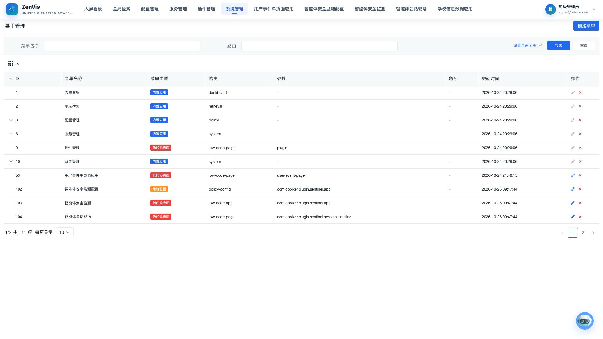
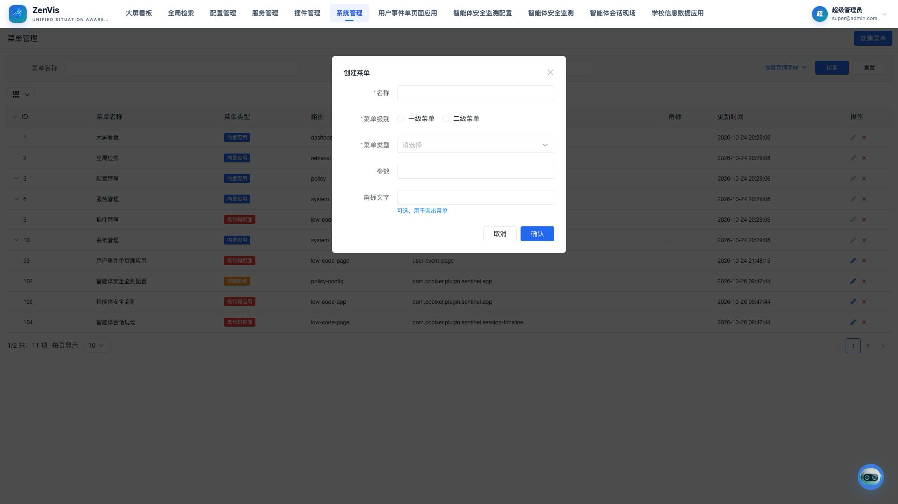

# 菜单管理

## 功能定位

菜单管理用于维护平台导航结构、页面路由和展示顺序。它决定用户登录后可以看到哪些入口，但用户最终能否访问某个入口，还取决于所属角色是否获得对应菜单权限。

## 进入方式

使用具备系统管理权限的账号登录，依次进入 **系统管理 → 菜单管理**。

## 页面说明

页面以表格展示菜单，主要信息包括 ID、菜单名称、菜单类型、路由、参数、角标和更新时间。存在二级菜单的行可展开查看子项；内置菜单用于承载平台基础能力，部分关键配置不可修改或删除。

新增弹窗用于设置名称、一级/二级菜单、父菜单、菜单类型、路由、参数和角标文字；菜单顺序在列表中通过拖动调整，并在页面提示保存排序时确认提交。

## 操作前检查

- 准备页面路由、参数、菜单类型、父级和目标角色；先在新窗口验证目标页面可打开。
- 检查是否已有同名或同路由菜单，避免重复入口。
- 调整内置或插件菜单前确认升级是否会覆盖变更。

## 核心操作

1. 点击“创建菜单”，填写名称，选择一级或二级菜单，再按入口用途选择内置应用、外联应用、低代码应用、低代码页面、HTML 页面或策略配置。

2. 二级菜单需要选择父菜单；类型为“内置应用”时填写路由。保存后确认导航层级与预期一致。
3. 如需调整现有菜单顺序，拖动目标行后按页面排序提示保存；不保留调整时刷新页面或按页面提供的重置操作放弃。

4. 菜单创建后，到角色管理中分配访问权限。

## 结果确认

- 保存后菜单层级、名称、排序和角标正确。
- 为测试角色授权并重新登录后入口可见，点击能进入预期页面。
- 未授权角色看不到入口，接口侧权限仍能阻止越权访问。

## 权限与约束

- 仅系统管理员或获得菜单管理权限的角色可以维护菜单。
- 路由必须与实际前端页面一致；错误路由会导致入口无法打开。
- 内置菜单是平台功能地图的一部分，不应被当作普通业务菜单删除。
- 菜单权限控制入口可见性，不能替代接口侧的数据权限校验。

## 常见问题

### 新菜单为什么没有出现在某个用户的导航中？

先检查菜单是否已正确挂载和排序，再检查该用户所属角色是否获得了对应菜单权限；必要时重新登录以刷新权限信息。

### 为什么某些菜单不能编辑或删除？

平台会保护影响基础功能的内置菜单。需要新增业务入口时，建议创建独立菜单，不要覆盖内置配置。

## 关联功能

- [角色管理](./角色管理.md)：为角色分配菜单权限。
- [静态页面配置](../配置管理/静态页面配置.md)：为静态业务页面准备可访问内容。
- [插件管理](../插件管理/插件管理.md)：插件可以声明并交付自己的动态菜单。
